Tool search is now visible, browsable and forgiving of typos. The toolbar button is a short "Search" below 1536 px (so the "Did you know?" strip keeps its room) and "Search tools… Ctrl+K" above it.

| Before (main) | After (this PR) |
|---|---|
| 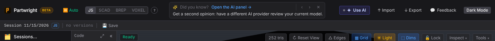 | 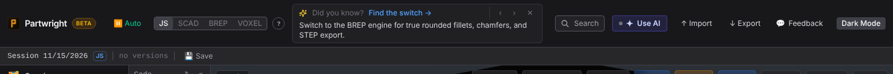 |
| — | 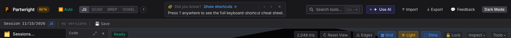 |
| 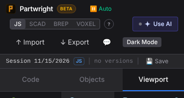 | 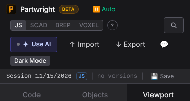 |
| 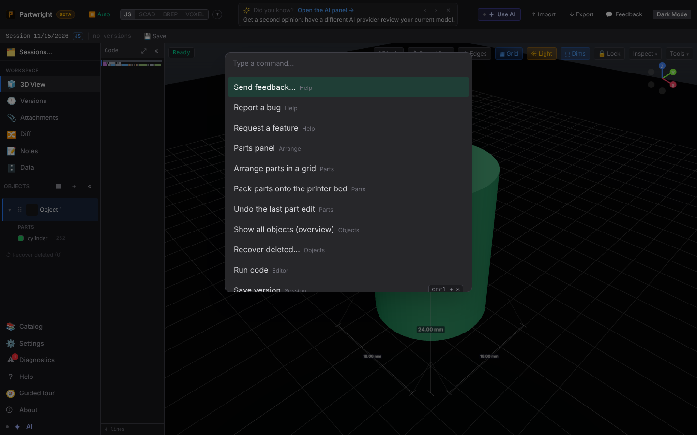 | 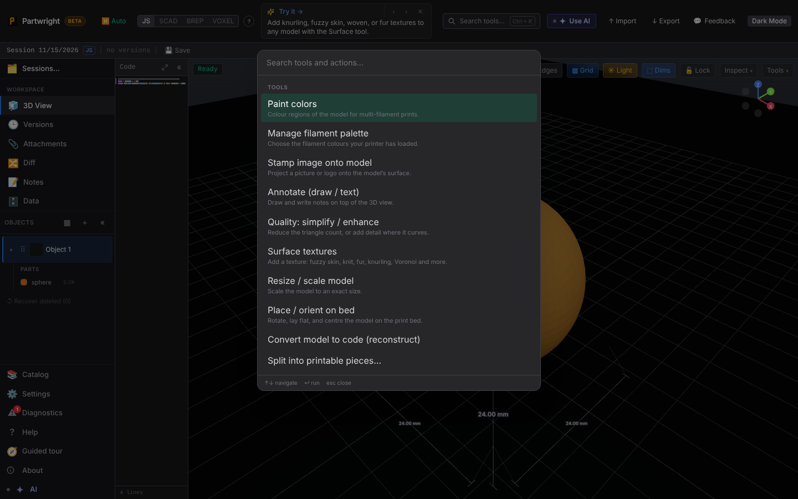 |
| 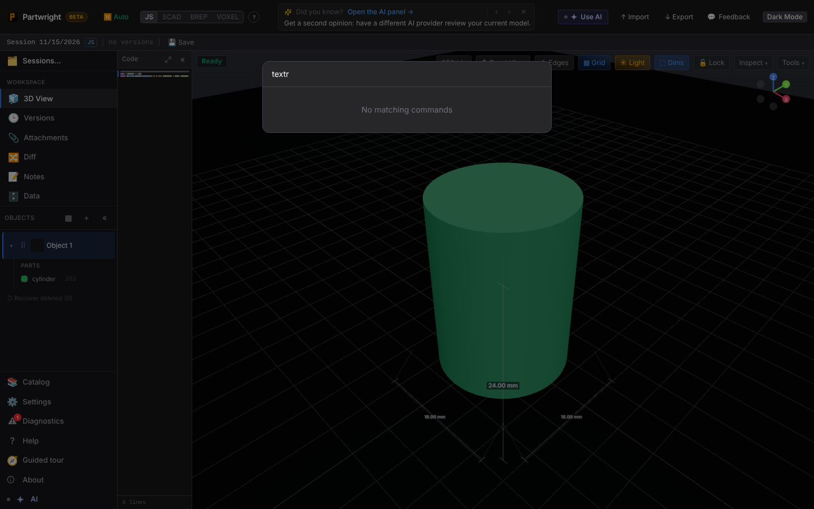 | 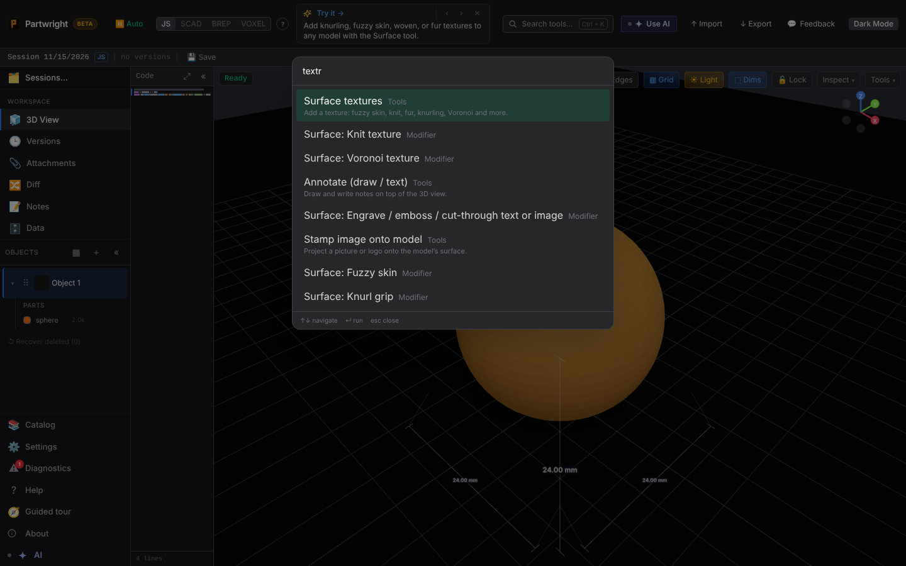 |

**Inspect menu:** ends with a search entry (the Tools menu only mentions Ctrl+K in its tooltip, since its row is already full).

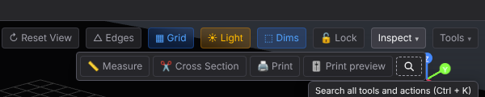

**New:** nothing matches → hand the query to the AI · phone width · light mode

| Ask the AI | Mobile (375 px) | Light mode |
|---|---|---|
| 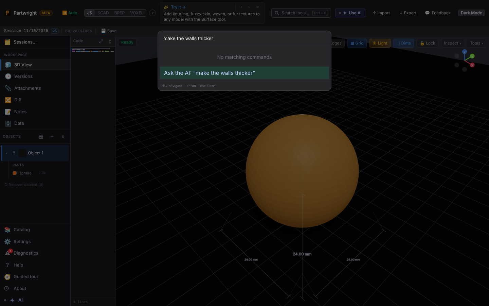 | 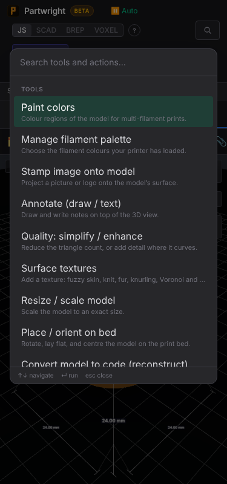 | 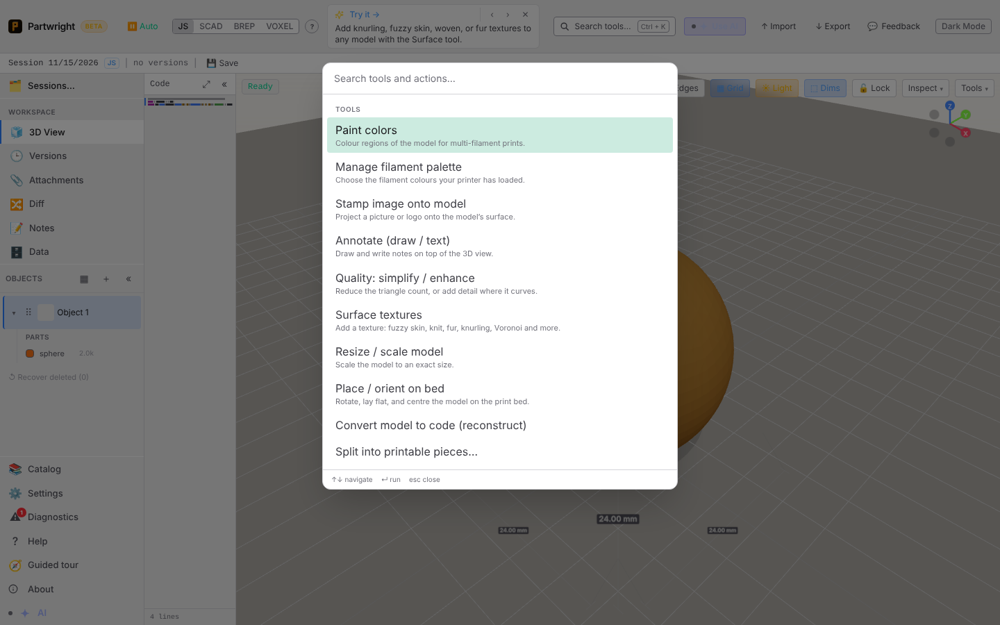 |
