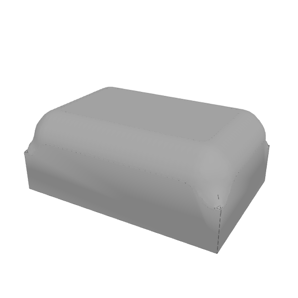
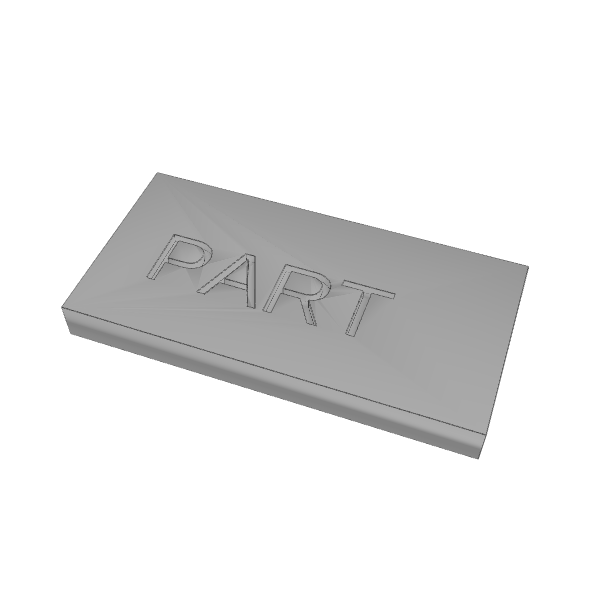

`renderView` with the default crease edges. Top row: `api.round(cube, { radius: 3, select: { where: { facing: 'up' } } })`. The seam outline around the edited zone is gone. Bottom row: an engraved plate, a control showing real walls keep their lines.

| Before (main) | After (this PR) |
|---|---|
|  |  |
|  |  |
