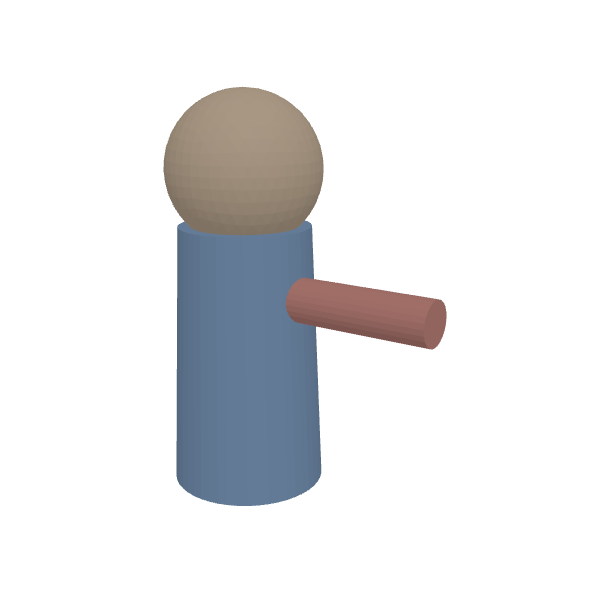
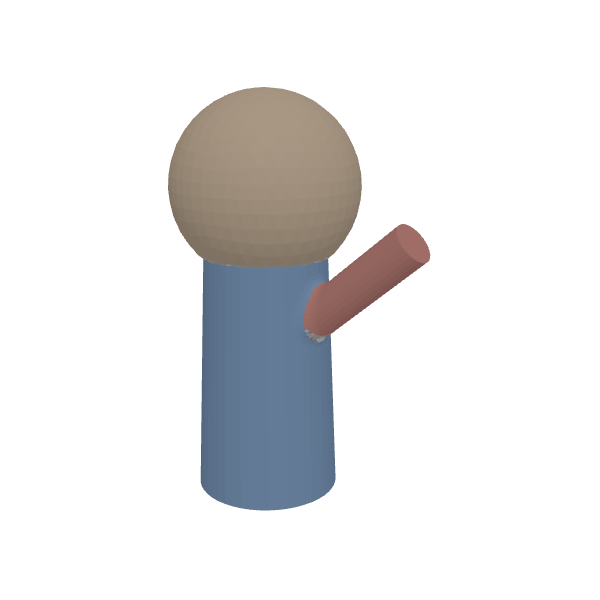
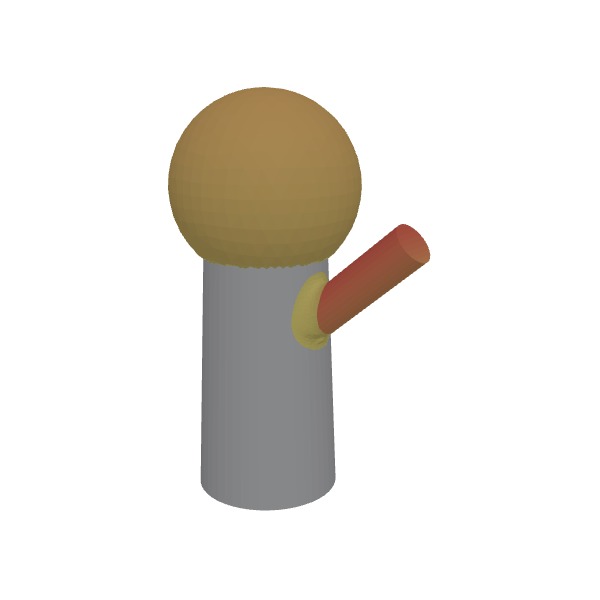
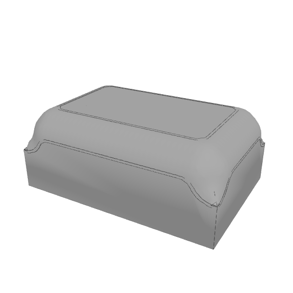

New mesh-editing ops from #1093, rendered in the app.

| Original | `api.editPart`: head ×1.3, arm turned 40° (blend 1.5) |
|---|---|
|  |  |

| `diffVersions(…, { geometry: true, render: true })` heatmap (grey = unchanged) | `api.round(box, { radius: 3, select: { where: { facing: 'up' } } })`: bottom edges stay sharp |
|---|---|
|  |  |
