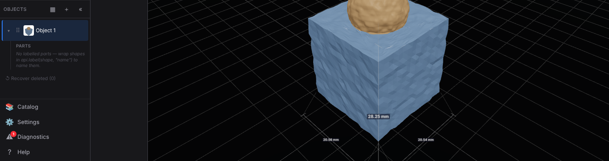
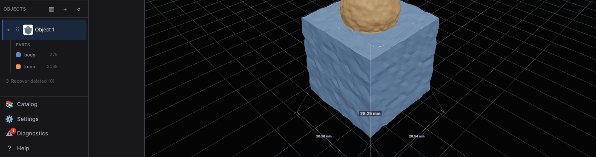

A labelled model (`body` + `knob`) after a baked fuzzy-skin texture. The Objects rail lists what survives the bake.

| Before (main): the parts are gone | After (this PR): both parts kept, with their colours |
|---|---|
|  |  |
