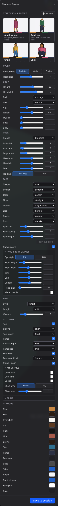
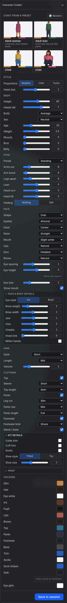

The Character Creator panel is now generated from `SPEC_FIELDS` (full panel, Details + Kit sections expanded). Same sections, labels and controls. Visible differences: option values are capitalized, a few rows reorder within their section, the new **Leg cut** control (`pants.leg` had none before), and the Sole reset shows disabled at its default, like the eye-layout reset.

| Before (main) — hand-built | After (this PR) — generated |
|---|---|
|  |  |
