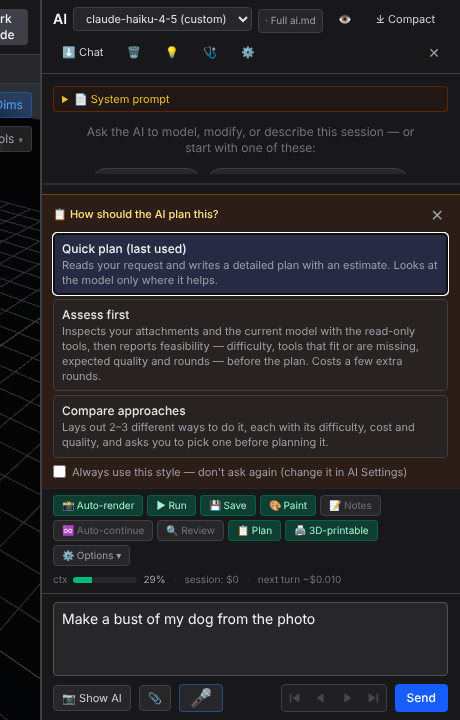
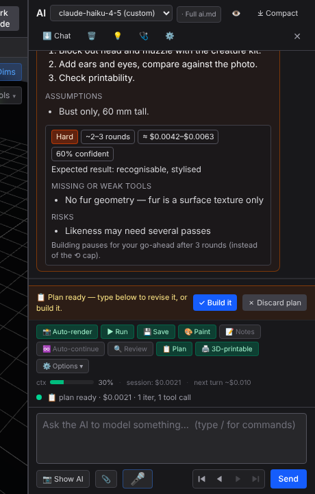
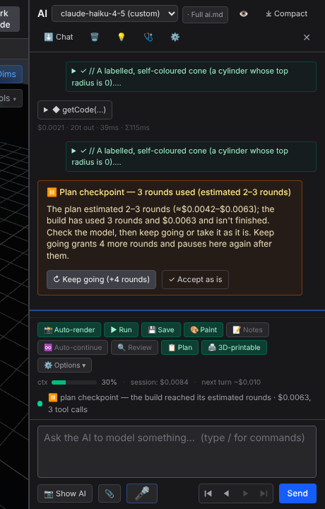

New plan-mode UI (AI panel), captured from `tests/ai-plan-estimate.spec.ts` with a stubbed model.

| Planning-style picker | Plan card with estimate | Build checkpoint (⟲ cap was 64) |
|---|---|---|
|  |  |  |
