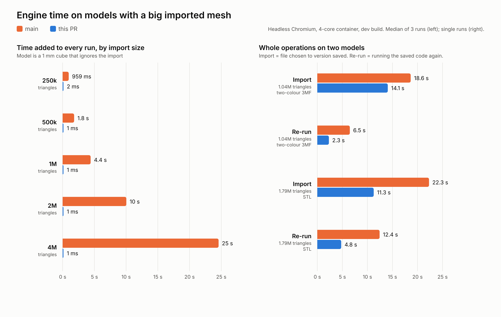
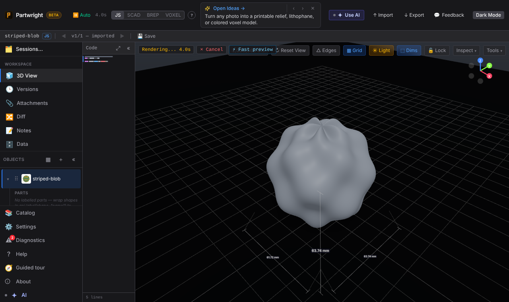
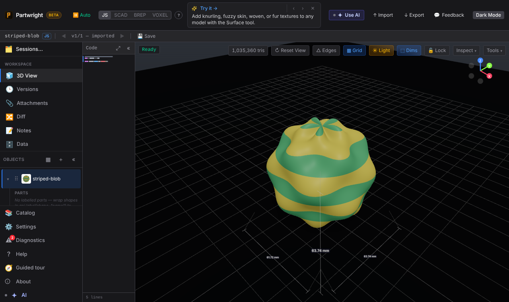

Benchmark, same spec on `main` and on this PR (headless Chromium, 4-core container, dev build):

The app four seconds into re-running a saved 1,035,360-triangle import (a generated striped blob, two colours). On `main` the engine is still rendering; on this PR the run has finished and the colours are back:

| Before (main) | After (this PR) |
|---|---|
|  |  |
