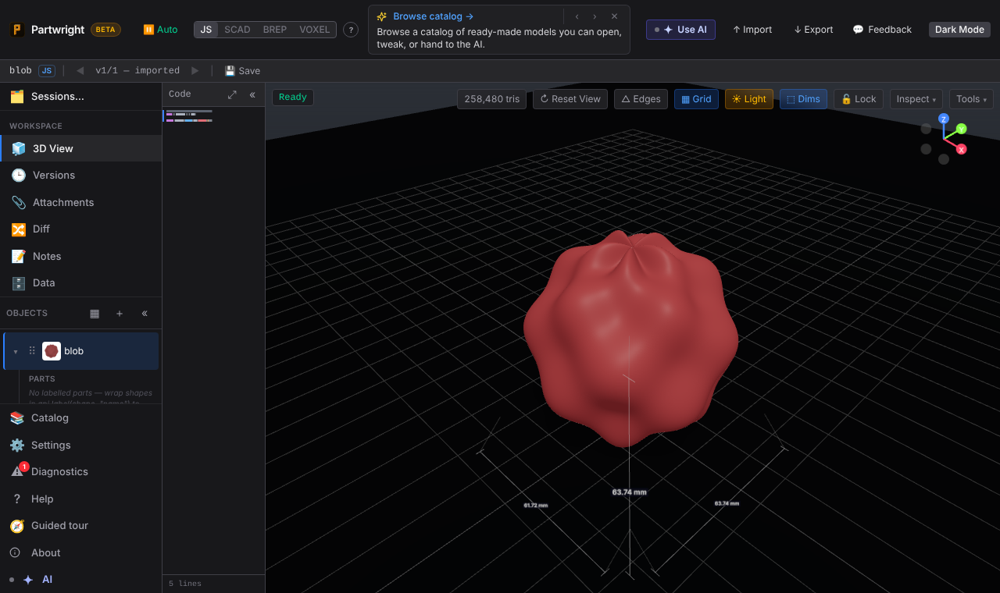
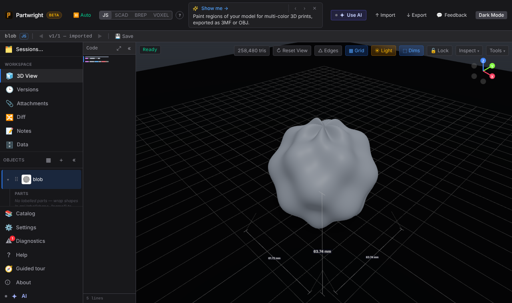

A large 3MF whose triangles all carry one colour now imports unpainted and leaves the active palette alone. Shown with a synthetic 258,480-triangle single-filament Bambu project (a generated blob). Below the big-mesh threshold (250k triangles) nothing changes: a small single-colour file still comes in painted.

| Before (main) | After (this PR) |
|---|---|
|  |  |
