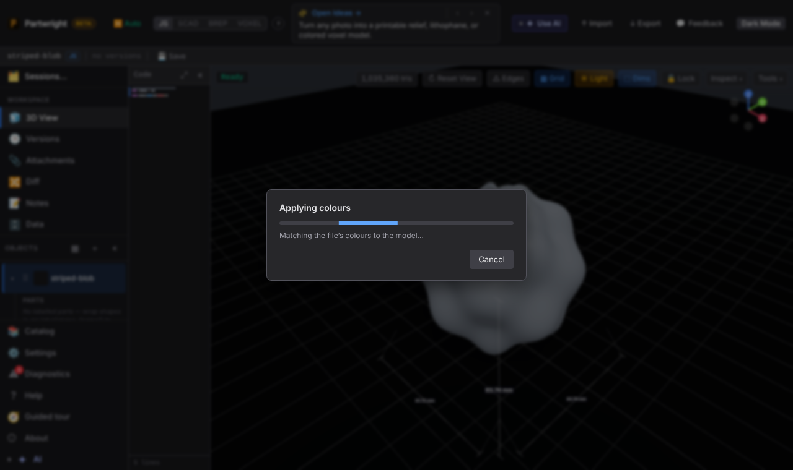
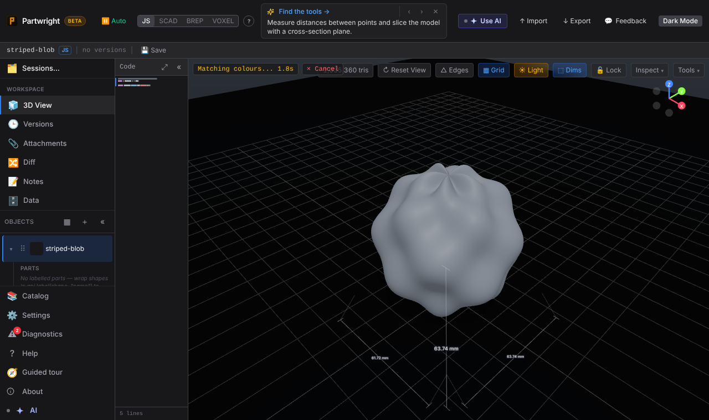
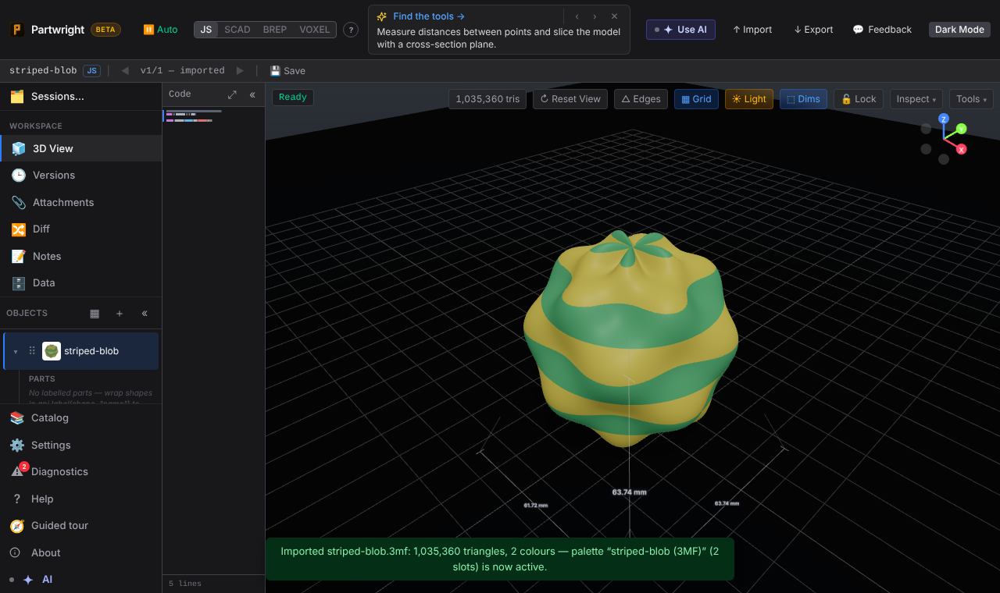

The colour pass of a big multi-colour import, shown with a synthetic 1,035,360-triangle two-colour model (a generated striped blob).

Before: a modal blocks the page while the colours are matched and applied. After: the uncoloured model stays usable under an inline "Matching colours… Xs" status with Cancel; "Applying colours…" and "Saving…" then name the steps that still block.

| Before (main) | After (this PR) |
|---|---|
|  |  |

When the pass finishes the colours are on the model and the status returns to Ready:

