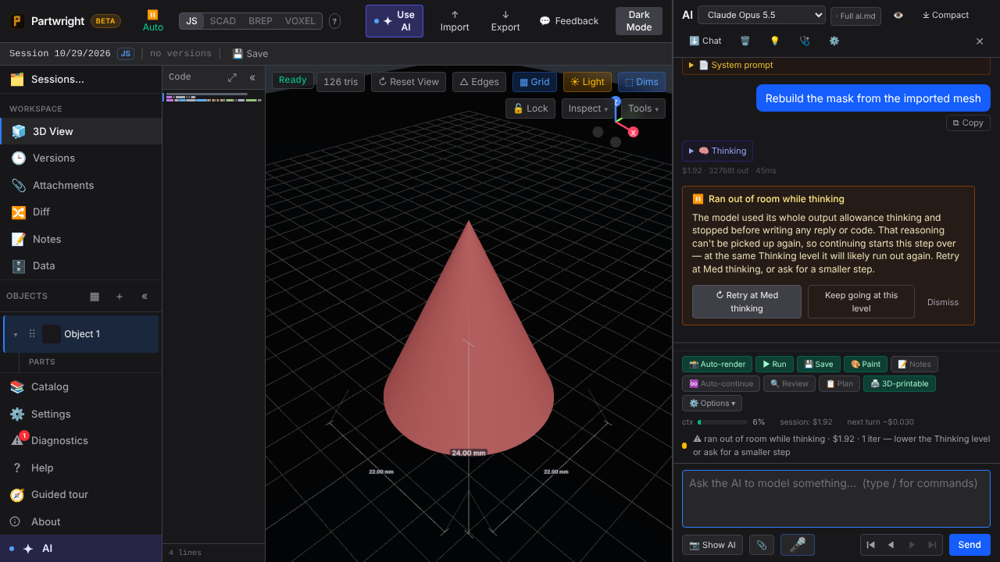
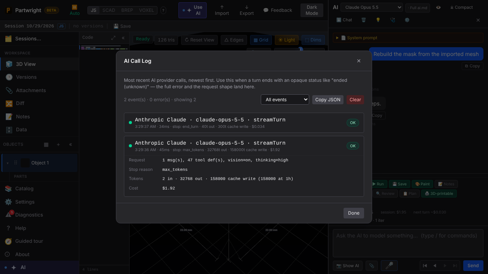

A High-thinking step that spends its whole output allowance thinking now gets its own notice, with a one-click retry one level lower. The AI Call Log shows cache writes (including the 1-hour part) and per-call cost. Both shots come from `tests/ai-thinking-cutoff.spec.ts`, which mocks the 32,768-token cut-off.

| Cut off while thinking | AI Call Log |
|---|---|
|  |  |
