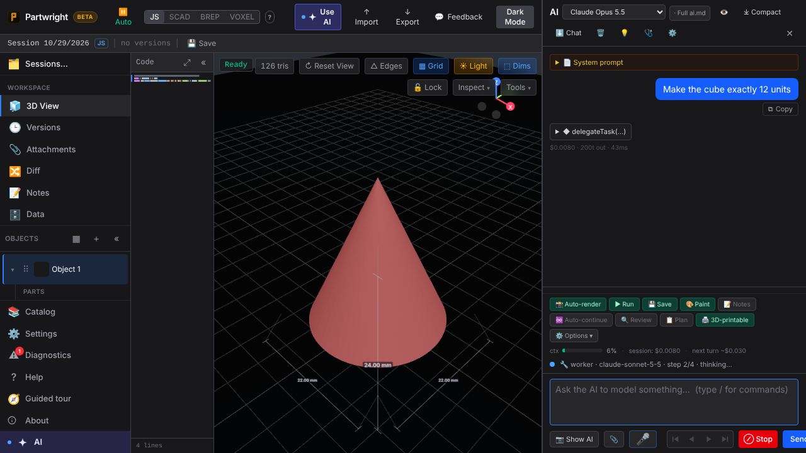

The main agent (Opus 5.5) calls `delegateTask`, and Sonnet 5.5 runs the sub-task in its own loop. The progress line names the worker and its step. Only the worker's report comes back, and the session total includes the worker's spend. Both shots come from `tests/ai-delegate-worker.spec.ts`, with the Anthropic API mocked.

| Worker running | Report returned |
|---|---|
|  |  |
