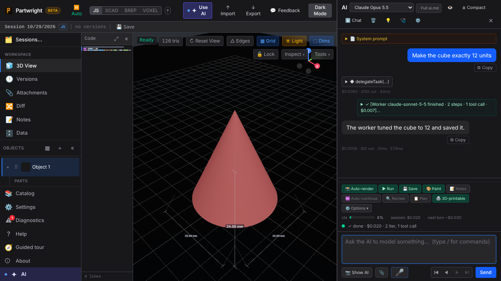
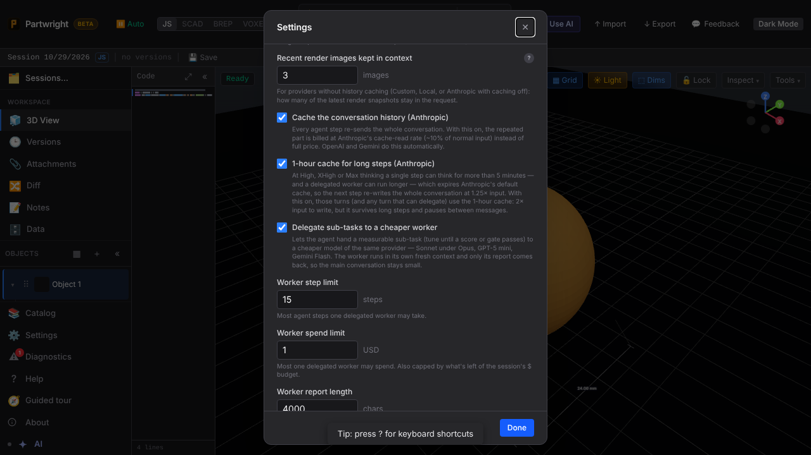

The main agent (Opus 5.5) calls `delegateTask`, and Sonnet 5.5 runs the sub-task in its own loop. The progress line names the worker and its step. Only the worker's report comes back, and the session total includes the worker's spend. Shots come from `tests/ai-delegate-worker.spec.ts`, with the Anthropic API mocked.

| Worker running | Report returned |
|---|---|
|  |  |

The new Advanced Settings: delegation on/off, worker step and spend limits, report length (the stall timeout and minimum budget sit just below). The 1-hour cache setting now also covers turns that can delegate.

