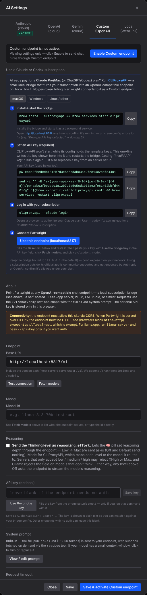
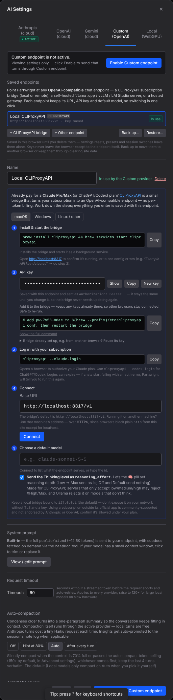
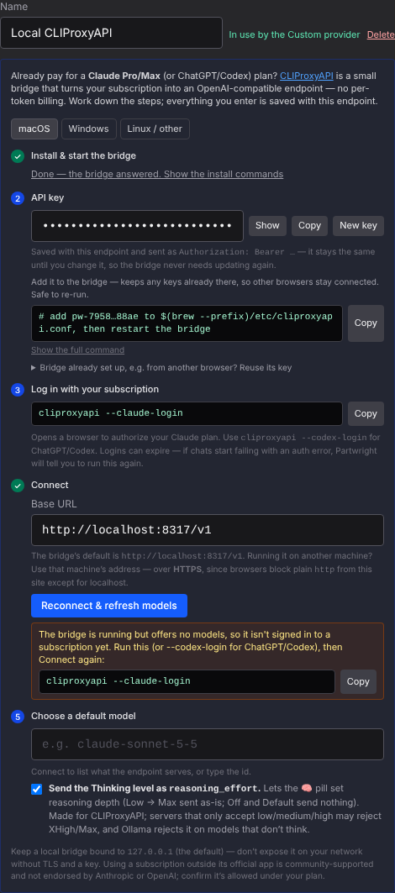
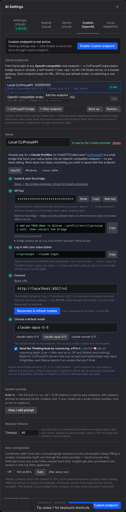
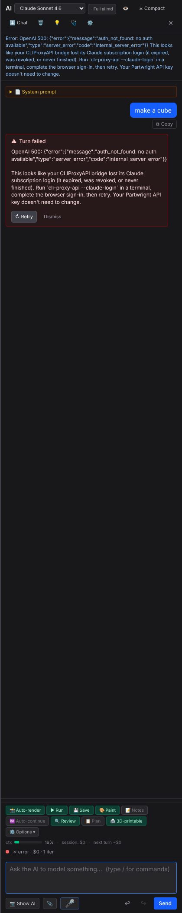
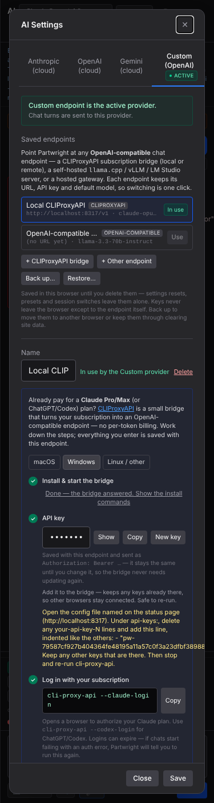

**Custom tab — before (main) / after (this PR).** The single endpoint form with a paste-at-the-bottom key becomes a list of saved endpoints plus a top-to-bottom editor; the CLIProxyAPI setup steps are the form itself.

| Before (main) | After (this PR) |
|---|---|
|  |  |

**Bridge answers with no models → login diagnosis** · **Two saved endpoints, bridge connected**

| Signed-out bridge | Connected + second endpoint |
|---|---|
|  |  |

**Chat turn against a bridge whose login lapsed** · **375 px**

| Chat error hint | Mobile |
|---|---|
|  |  |
