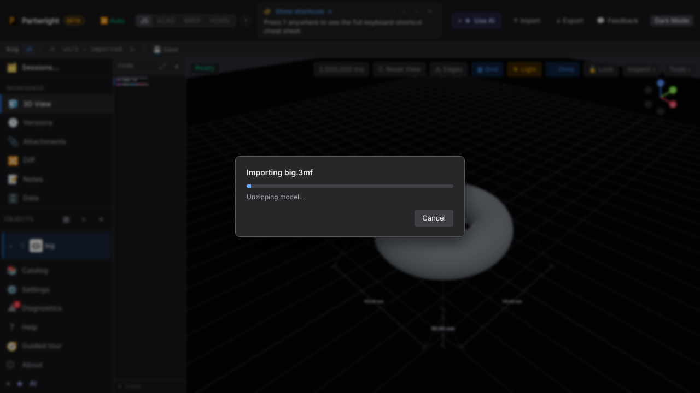
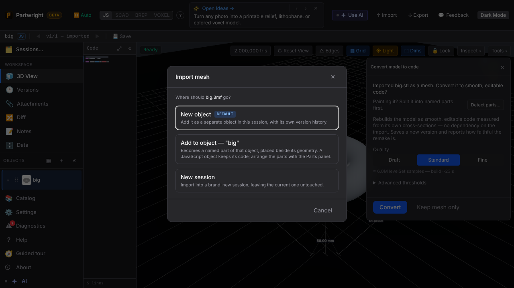

Importing a 3.7M-triangle 3MF (44 MB zip) while a 2M-triangle STL is open. On `main` the page froze for **19.0 s**. With this PR, the longest main-thread stall is **116 ms**, and a cancellable progress modal shows each stage.

| While parsing (this PR) | Parse finished → import target |
|---|---|
|  |  |
