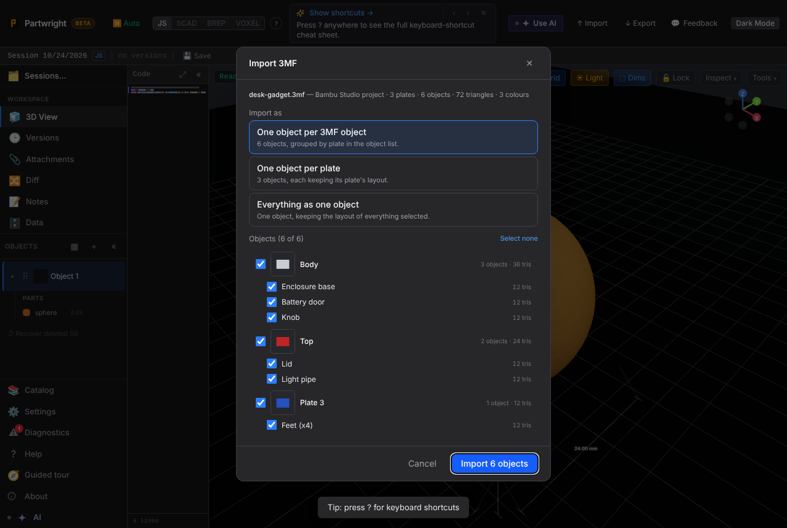
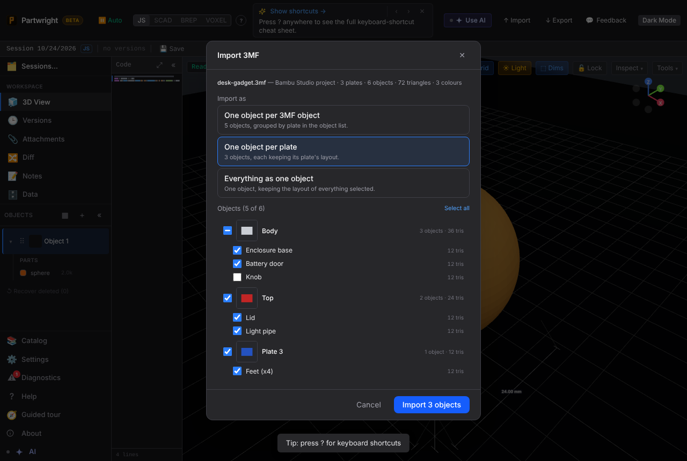
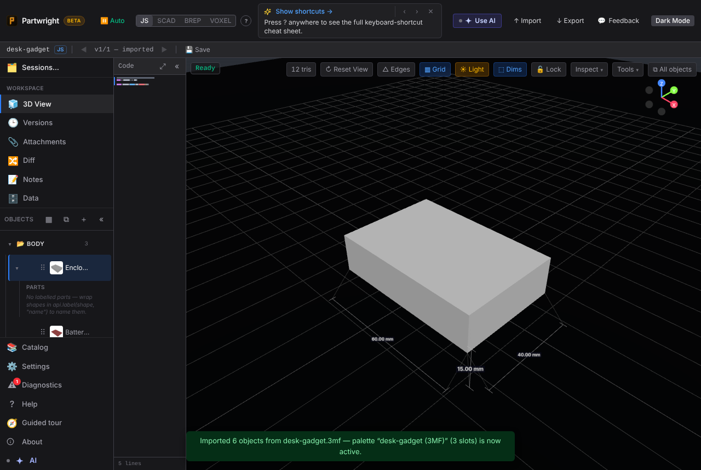
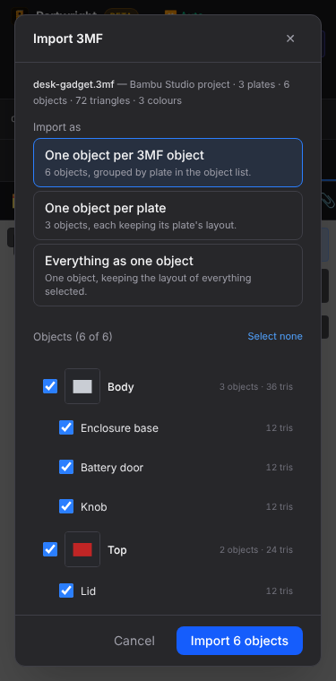
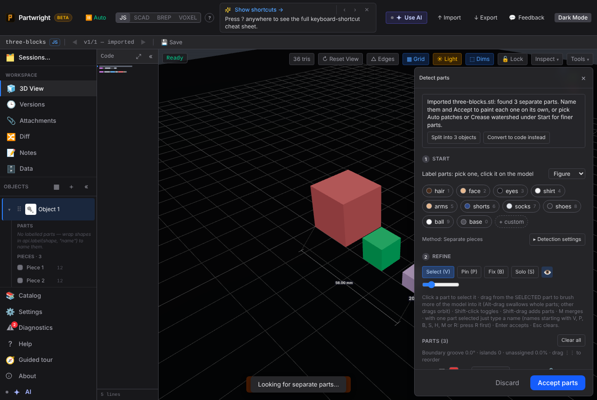
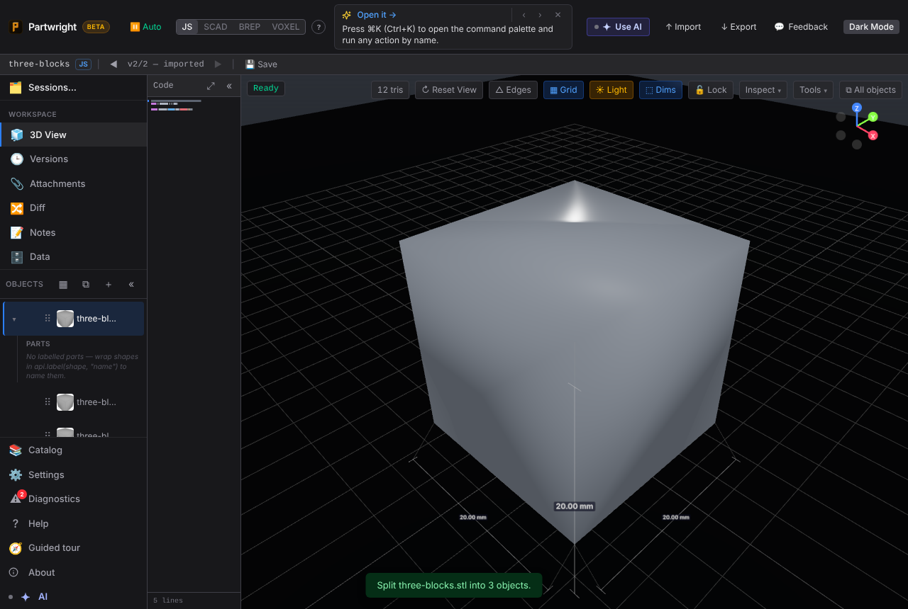
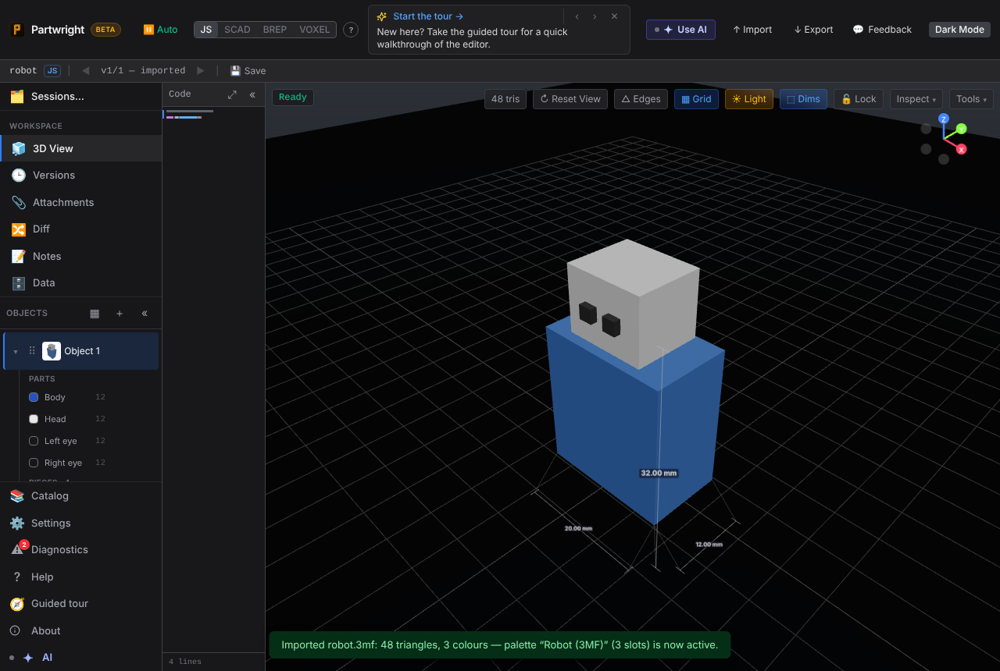

**3MF with several objects on several Bambu plates** — the new Import 3MF chooser (desktop, and "One object per plate" with one object unticked):

| Chooser | Per-plate mode |
|---|---|
|  |  |

**Result** — one object per 3MF object, threaded under its plate group, first object framed. Mobile (375 px) chooser:

| Imported | Mobile |
|---|---|
|  |  |

**Multi-body STL** — the post-import part proposal gains "Split into N objects":

| Proposal | After split |
|---|---|
|  |  |

**Parts inside a 3MF object** (#1104) — a Bambu object with four named parts imports with them as labelled parts of the object:

