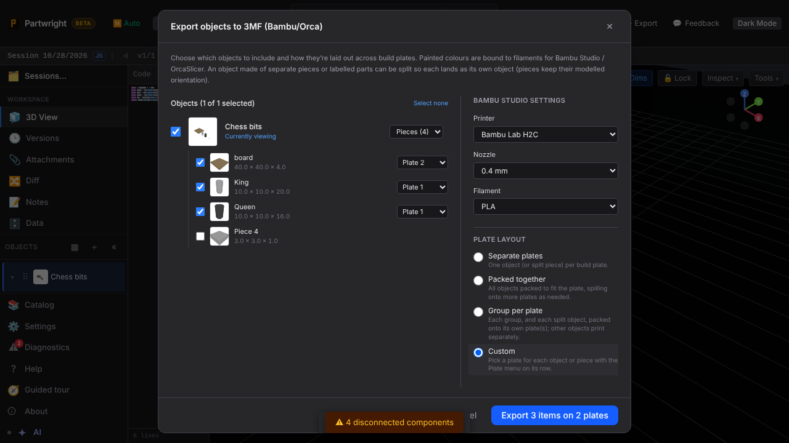
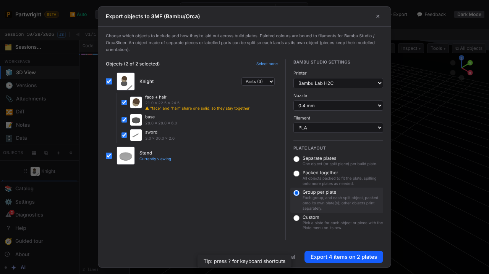
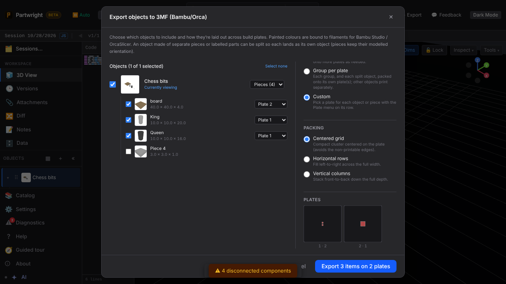
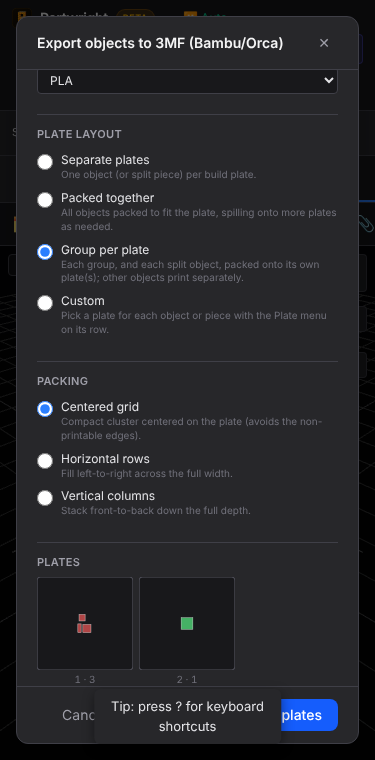

Export picker with the new **Split** menu: a single object of four separate solids split into pieces, its unlabeled tab left out, laid out with Custom plates. A Parts split keeps labels that share a solid together and says why. The plate preview uses the same packer as the exporter.

| Pieces + Custom plates | Parts (fused labels stay together) |
|---|---|
|  |  |

| Plate preview | 375 px |
|---|---|
|  |  |
