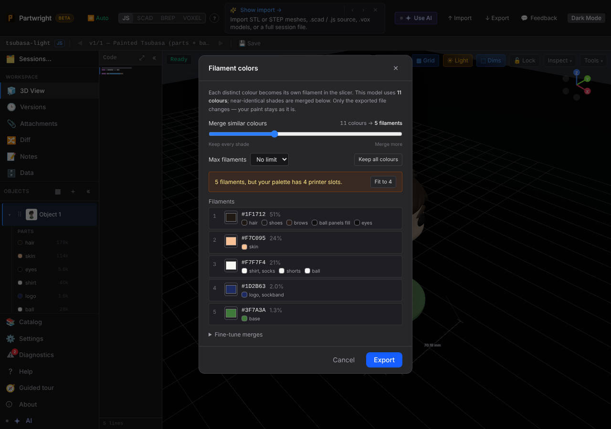
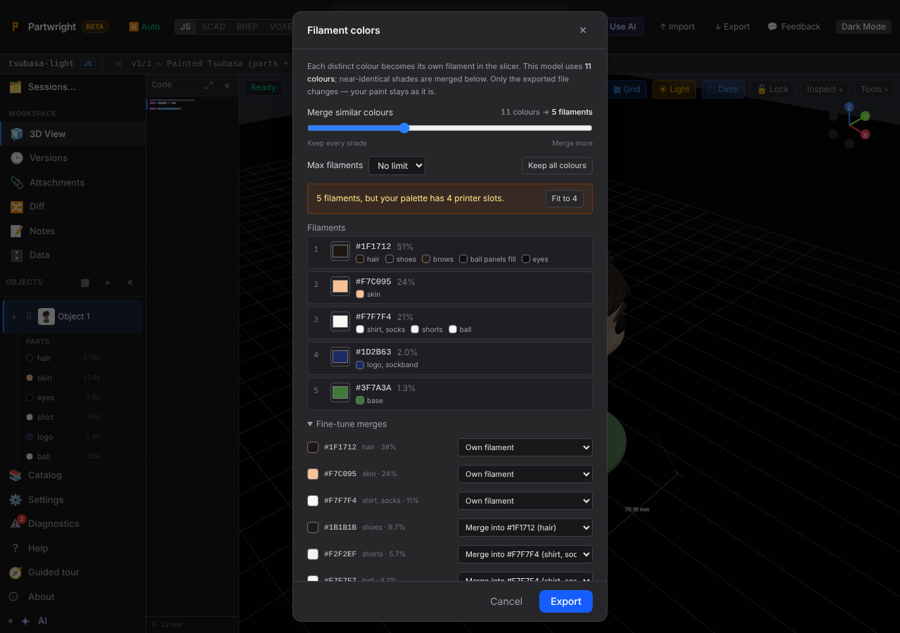
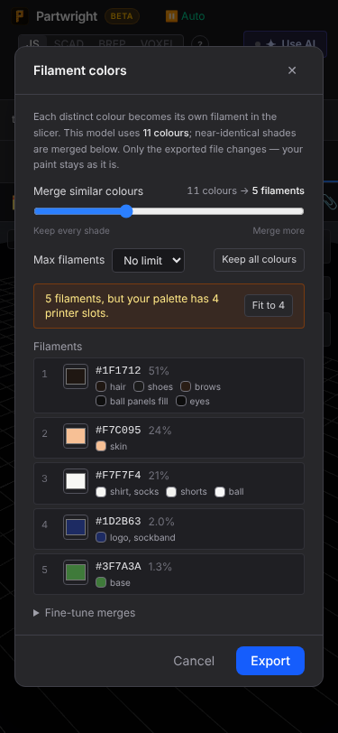

The 3MF exports now open a **Filament colors** step. Shown with the reporter's painted figure: 11 painted colours (five near-blacks, three near-whites) collapse to the 5 visible filaments at the default tolerance.

| Filament colors (desktop) | Fine-tune merges |
|---|---|
|  |  |

| 375 px |
|---|
|  |
