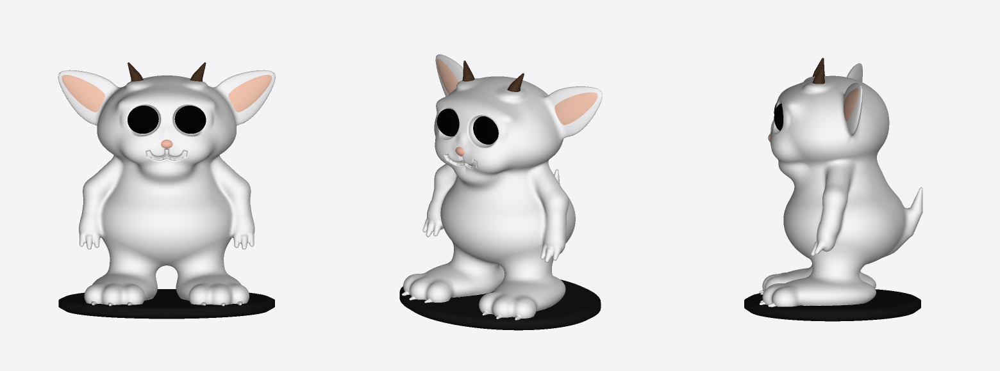
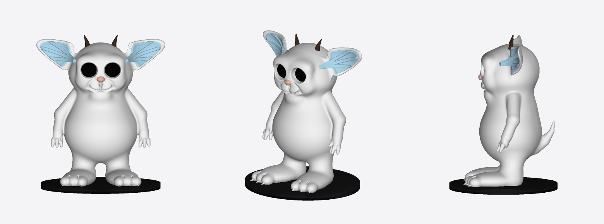
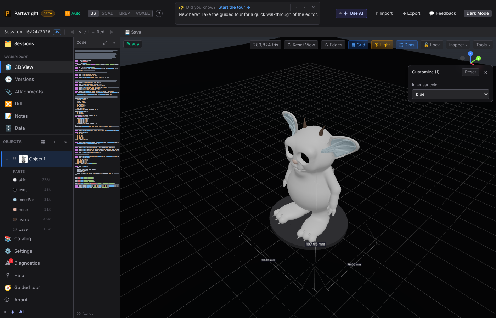

Ned built with the new `api.sdf.creature` kit (`examples/creature_ned.js`), shown front, 3/4 and side, next to the in-app AI's pure-SDF attempt at the same angles.

| Before: in-app AI, pure SDF |
|---|
|  |

| After: `api.sdf.creature` (one manifold piece, genus 3) |
|---|
|  |

Running in the real editor through the app's Worker sandbox, with the labelled parts listed:

