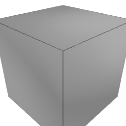
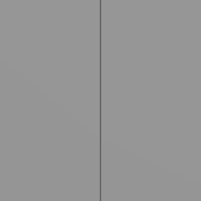
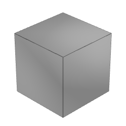

A closed hollow shell with a small labelled `peg` inside it, rendered with `renderView`:

| Whole model | `focus: "peg"` | `focus: "peg", clip: true` |
|---|---|---|
|  |  |  |

Without `clip`, the zoomed camera stays outside the model, so the shell wall in front of the peg still blocks it (what a viewer would see). With `clip`, everything outside the padded focus box is hidden and the peg shows. `probePixel` with the same view options hits the shell and the peg respectively.
