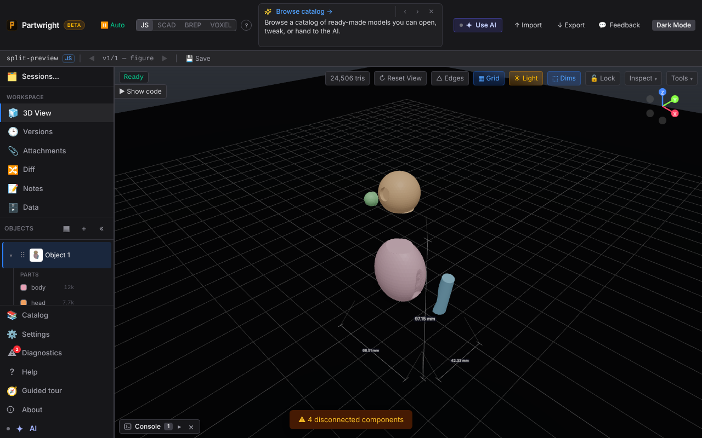
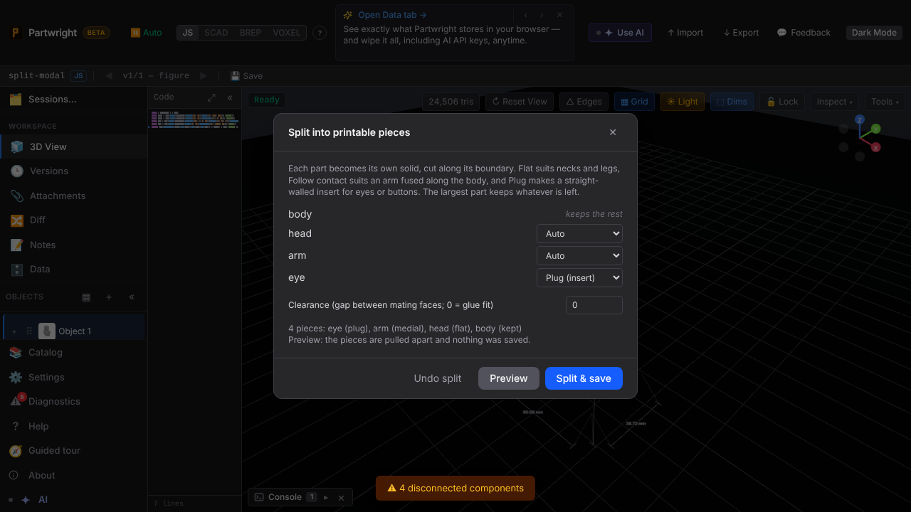

`splitIntoPieces` on a labelled test figure. Left: the preview in the viewport, with pieces pulled apart (the head has a straight-walled eye socket and the body has the medial arm pocket). Right: the Split modal (palette / Tools → ✂ Split).

| Preview (pieces pulled apart) | Split modal |
|---|---|
|  |  |
