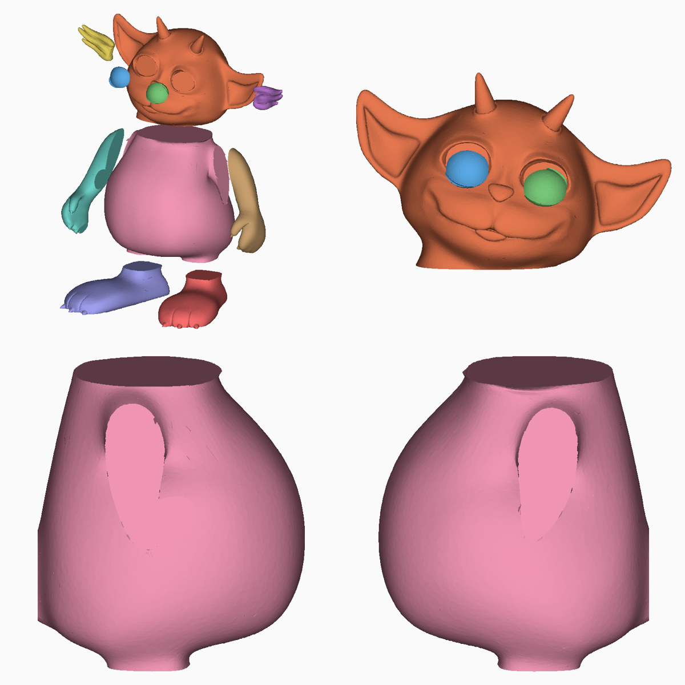
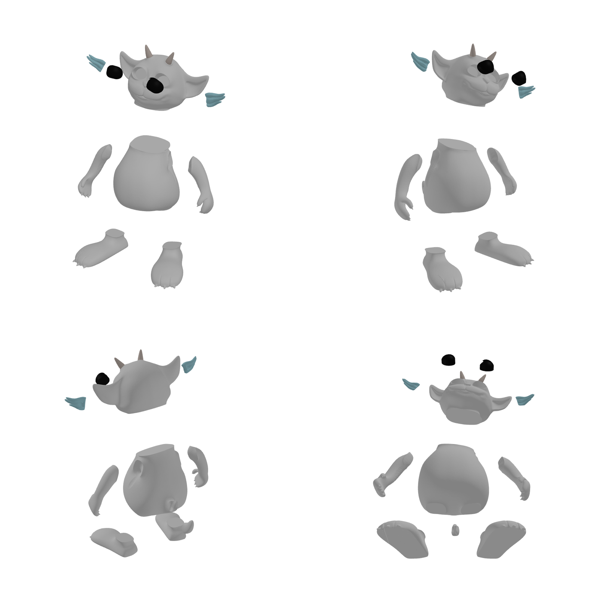
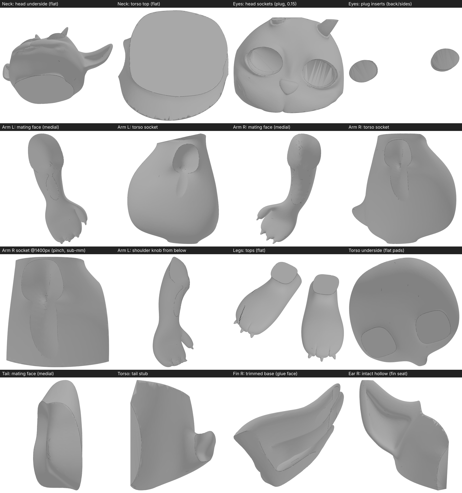
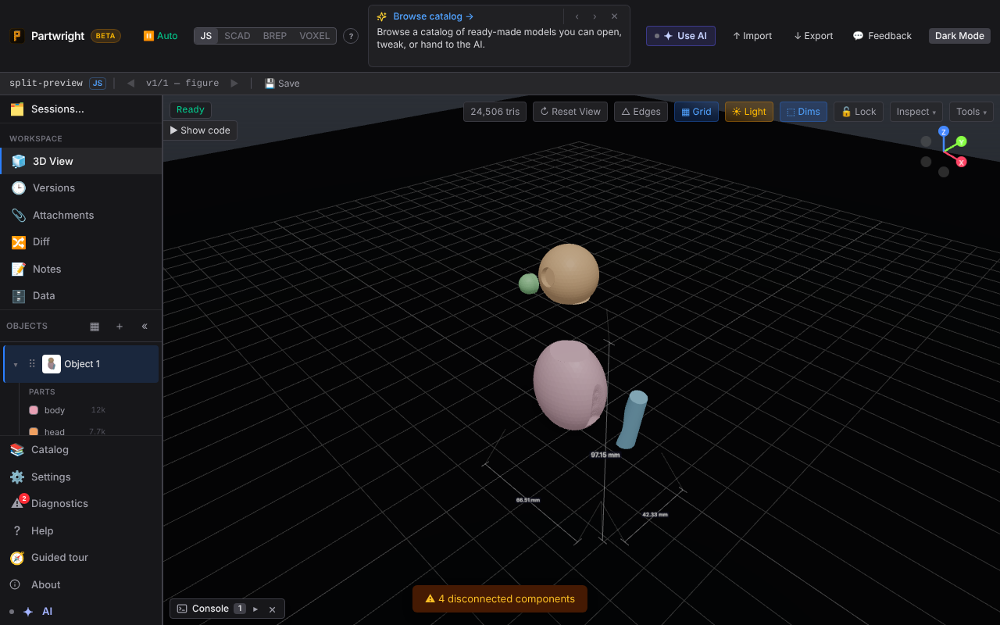
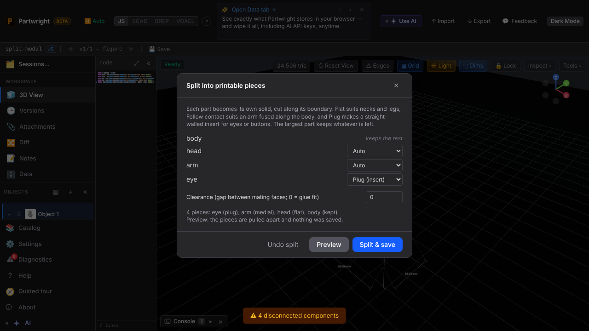

**NED, cut with `splitIntoPieces`.** The original NED_V2 figure (3.75M triangles, simplified to about 400k) was cut into 11 pieces by an agent driving the real app. Detect parts → accept → `splitIntoPieces` (plug eyes, medial arms and tail, flat neck and legs, 0.15 mm clearance; the fins are separate shells, trimmed to the ears). Every piece is a single watertight solid, no two overlap, and each slides out of its neighbour.

| Before: the failed hand-placed cuts (flat scars and leftover arm skin on the torso, eyes off their sockets) | After: 11 pieces, pulled apart |
|---|---|
|  |  |

**Both sides of every seam:** neck, eye sockets and plugs, arm sockets, leg pads, tail, fins.

**The tool:** the preview in the viewport (pieces pulled apart) and the Split modal (palette / Tools → ✂ Split).

| Preview | Split modal |
|---|---|
|  |  |
