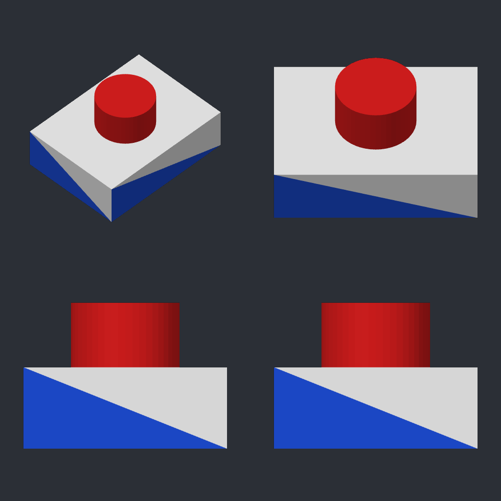
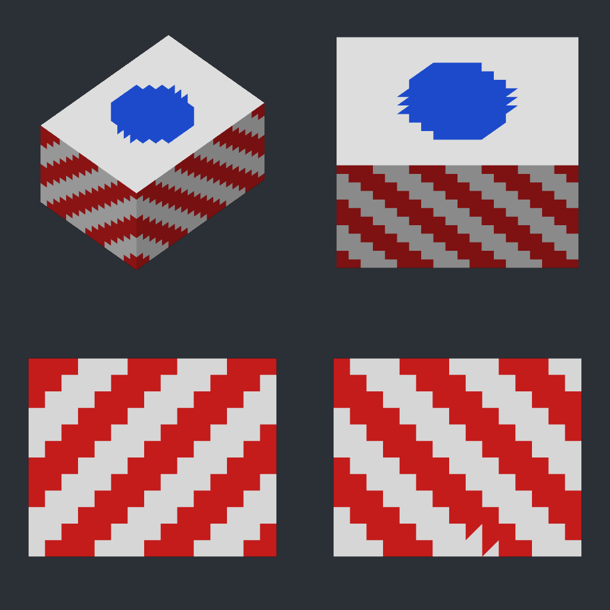

Contact sheets written by `slicer-cli check` (`renders.sheet`): the real slicer's own plate renders of files exported by Partwright.

| Model file → real app export → slicer | An existing `.3mf` |
|---|---|
|  |  |

Left: every check passed (3 filaments), yet the blue band meant to be 3 mm tall is a diagonal wedge, because paint is per triangle and the box side is two triangles. This is why the agent instructions say to look at the sheet at checkpoints.
