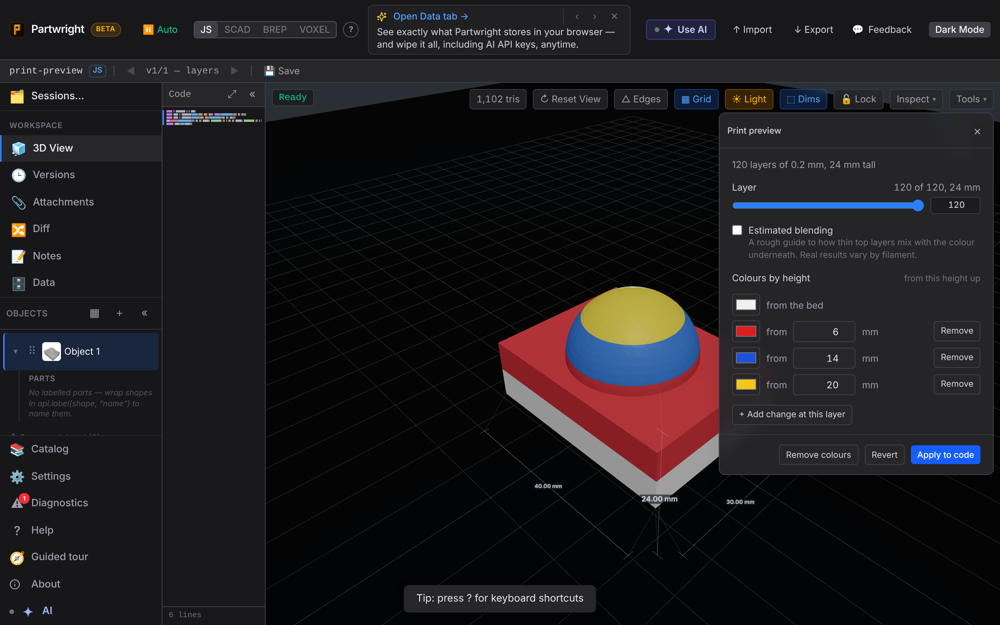
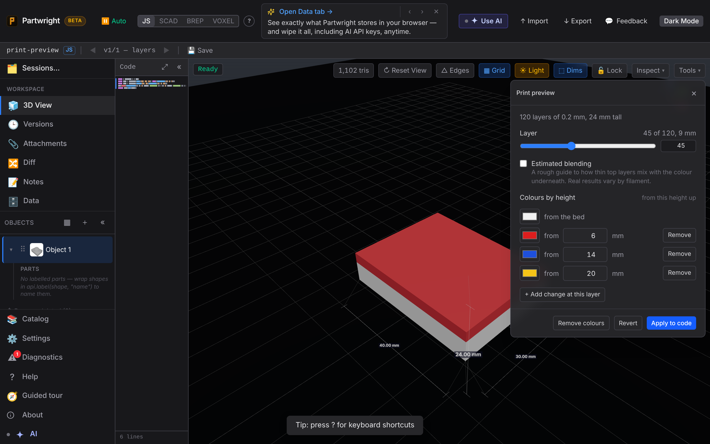
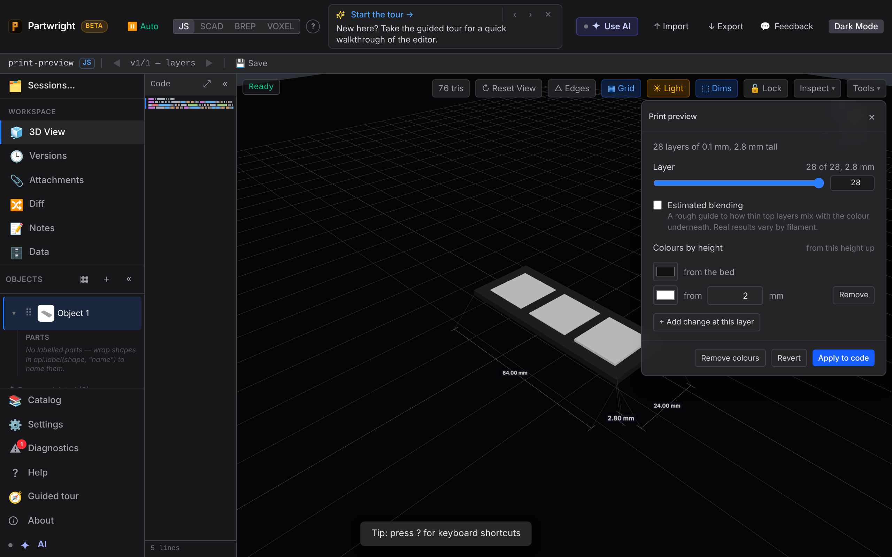
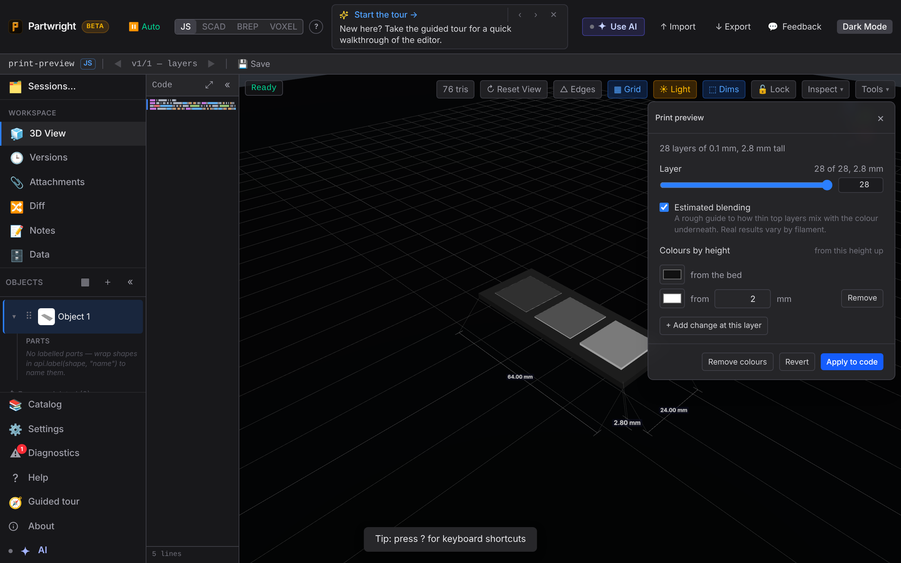
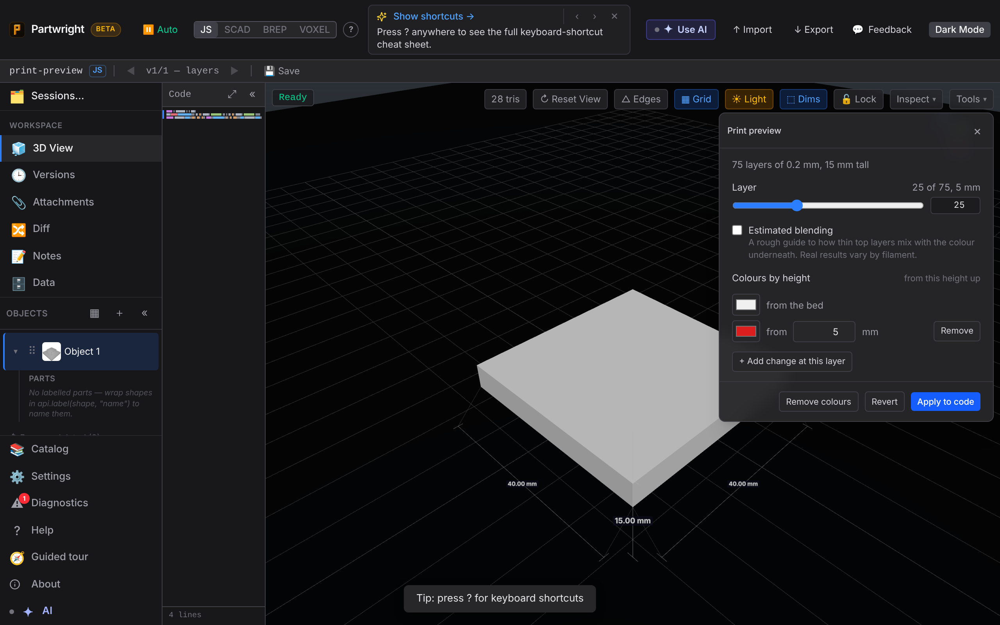
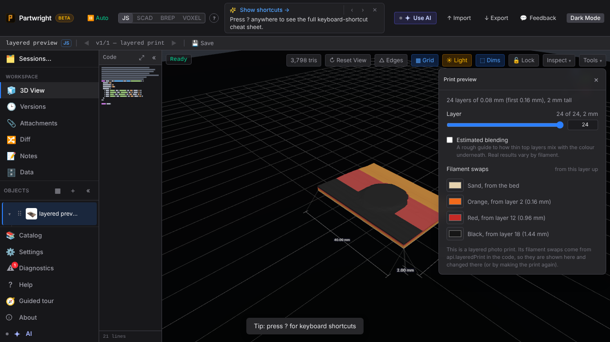
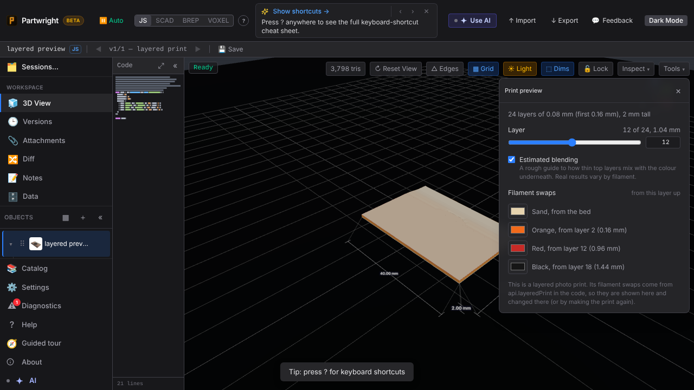
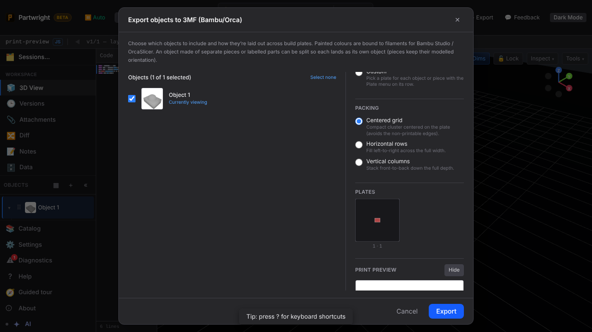
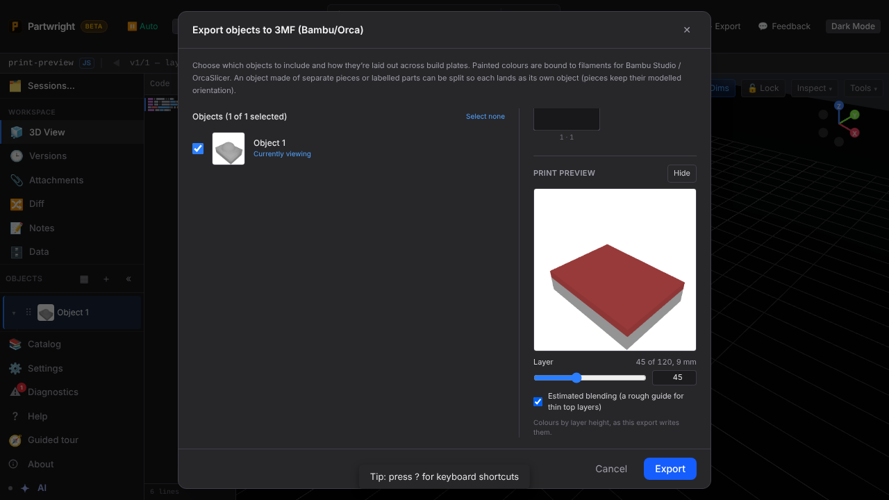

Print preview (Inspect → Print preview): a model whose code declares colours by layer height, shown as the bands that will print.

| Whole model | Layer slider at 45 of 120 |
|---|---|
|  |  |

Estimated blending on a dark plaque with white tops 1, 3 and 8 layers thick (0.1 mm layers):

| Blending off | Blending on |
|---|---|
|  |  |

A cut that lands exactly on a step (the top of the slab, where a tower starts) is capped across the whole section:

A layered photo print (made from a synthetic picture) previews from its own swap plan. The swaps are listed read-only.

| Raw filament per layer | Layer 12 of 24, with the print's own predicted colours |
|---|---|
|  |  |

The 3MF export dialog has an optional Print preview block:

| Shown, whole object | Layer 45 of 120, blending on |
|---|---|
|  |  |
