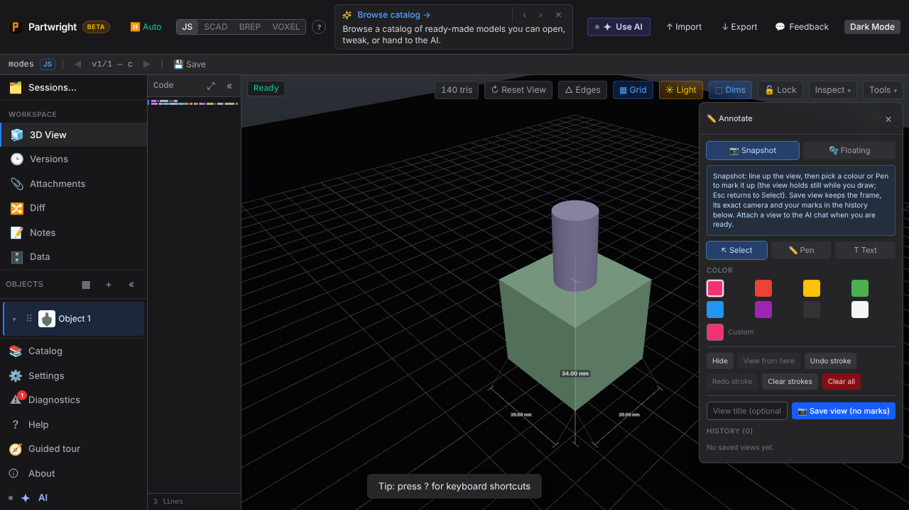
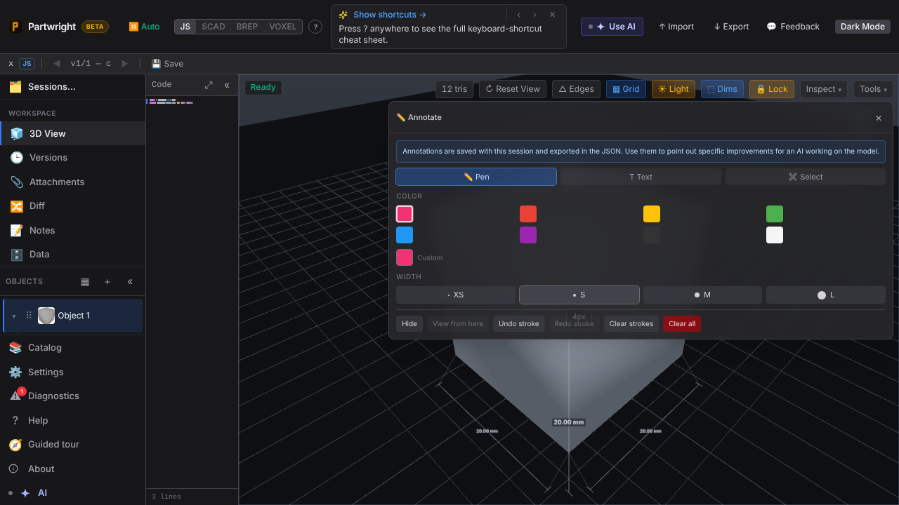
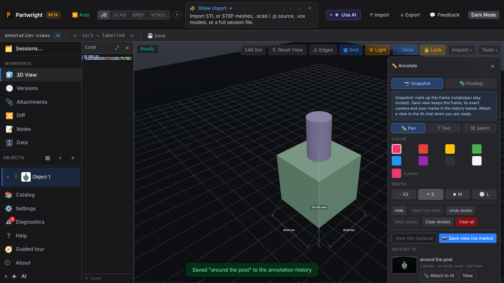
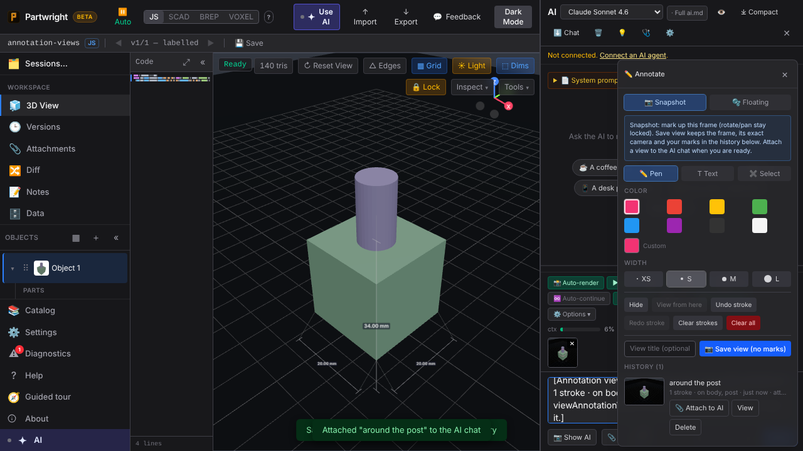
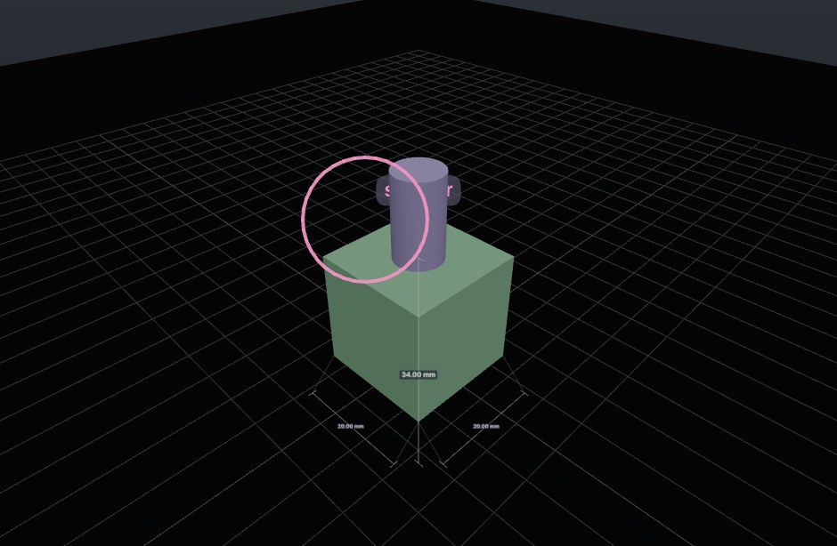
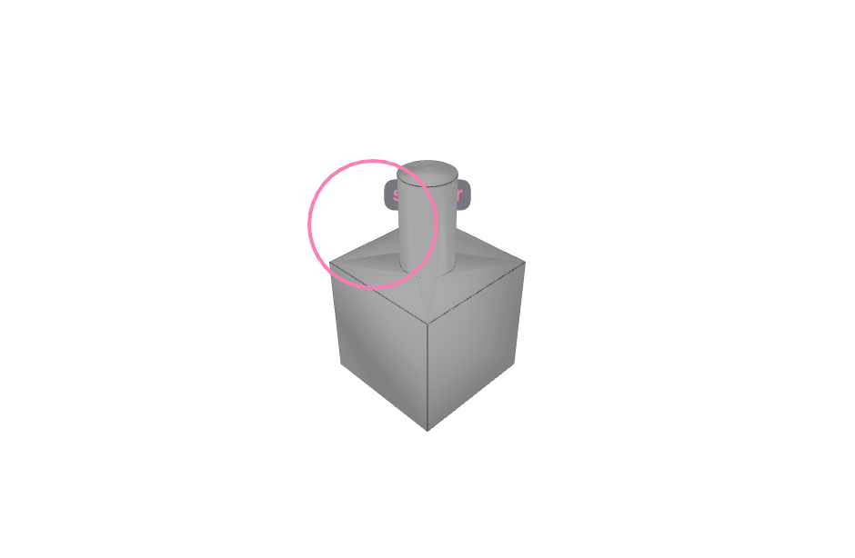

**Annotate opens in Select.** The cursor tab is leftmost and active, the view orbits as usual, and the toolbar Lock stays off. Picking a colour or Pen/Text starts drawing and freezes the view. Esc returns to Select.

**Snapshot annotation views.** Mark up the frame, then Save view. The history row shows the captured frame and what the mark hit (here, "on body, post"). The panel is now 288px wide instead of covering the viewport.

| Before (main) | After (this PR) |
|---|---|
|  |  |

**Attach to AI** stages the frame plus a one-line summary in the chat input. Nothing is sent.

**What the agent gets.** Left: the saved frame (exact camera, marks included). Right: `viewAnnotationView({fresh: true})`, the current model re-rendered from the same camera with the marks on top.

| Saved frame | Fresh render, same camera |
|---|---|
|  |  |
