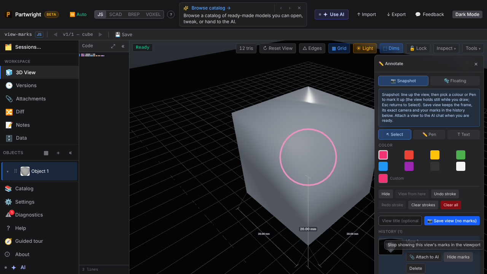
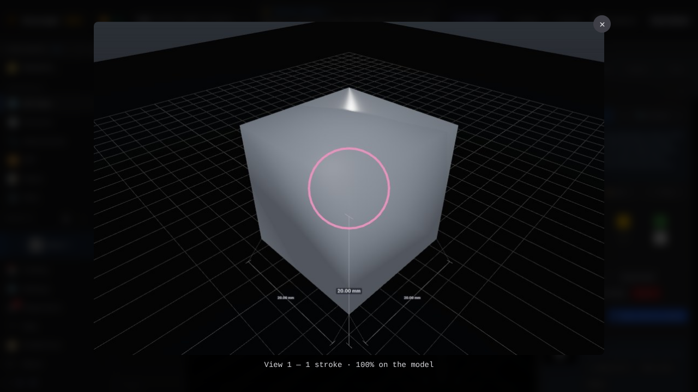

**View redraws the marks.** After orbiting away, **View** snaps the camera back to the saved angle and redraws that view's marks. The row now offers **Hide marks**.

**Clicking the thumbnail** opens the saved frame full size, captioned with what the marks hit. Esc closes only the lightbox.

