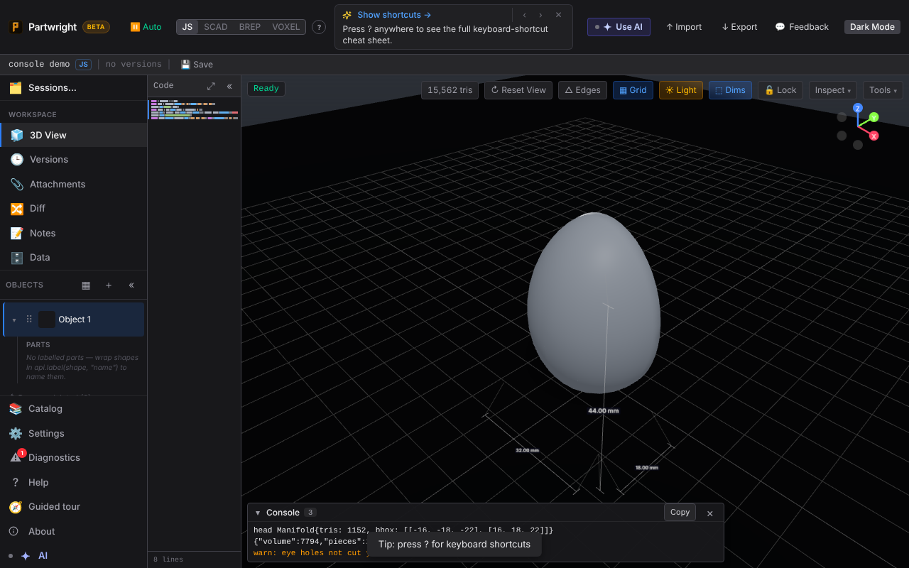
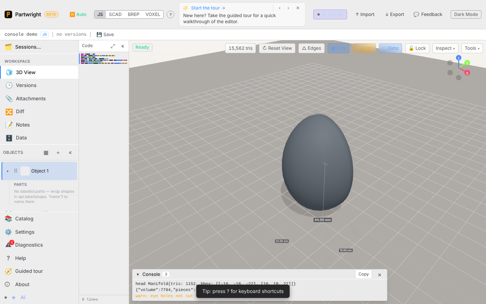
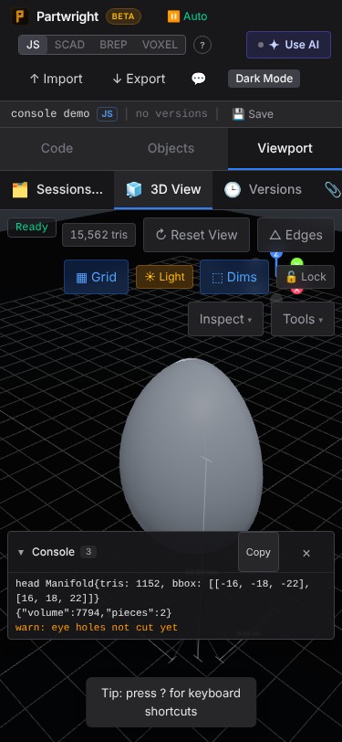
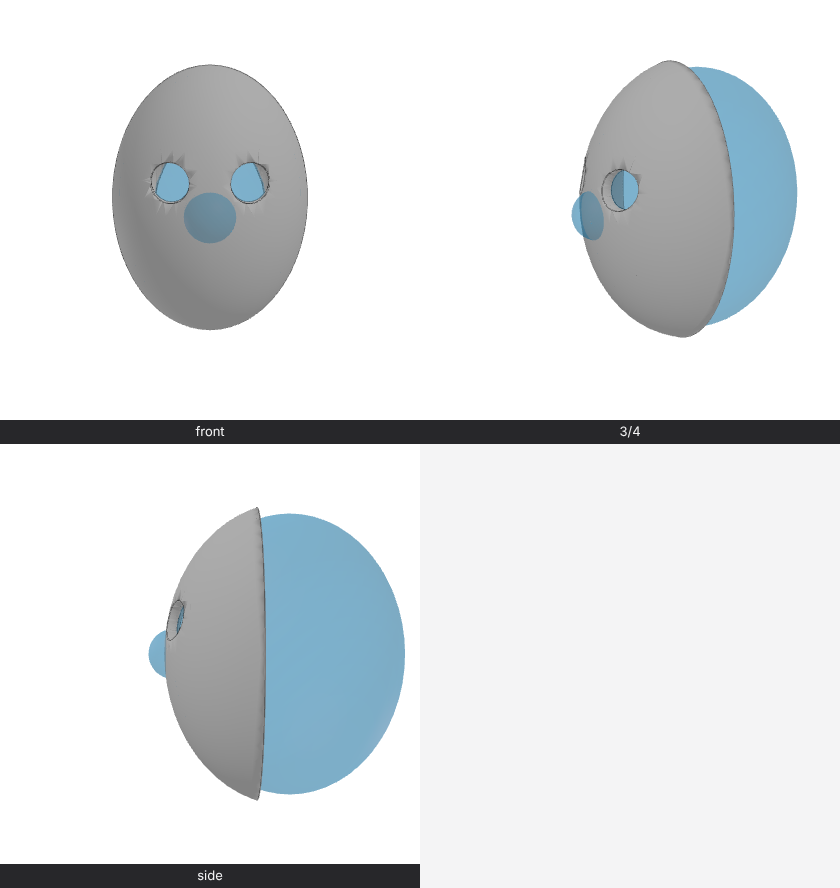
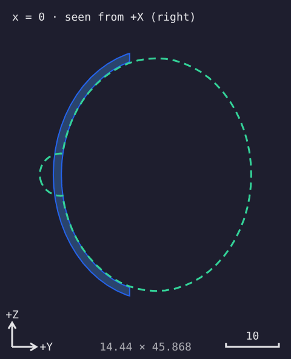
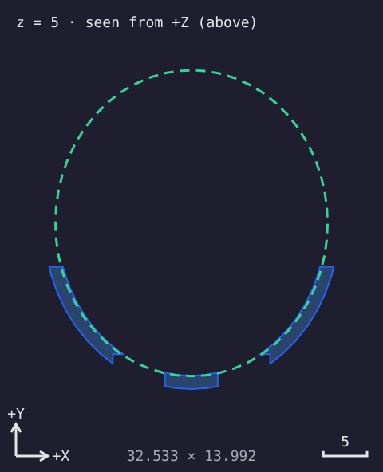
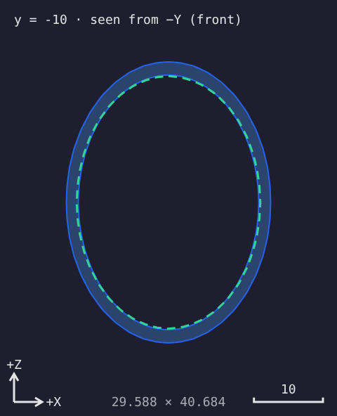
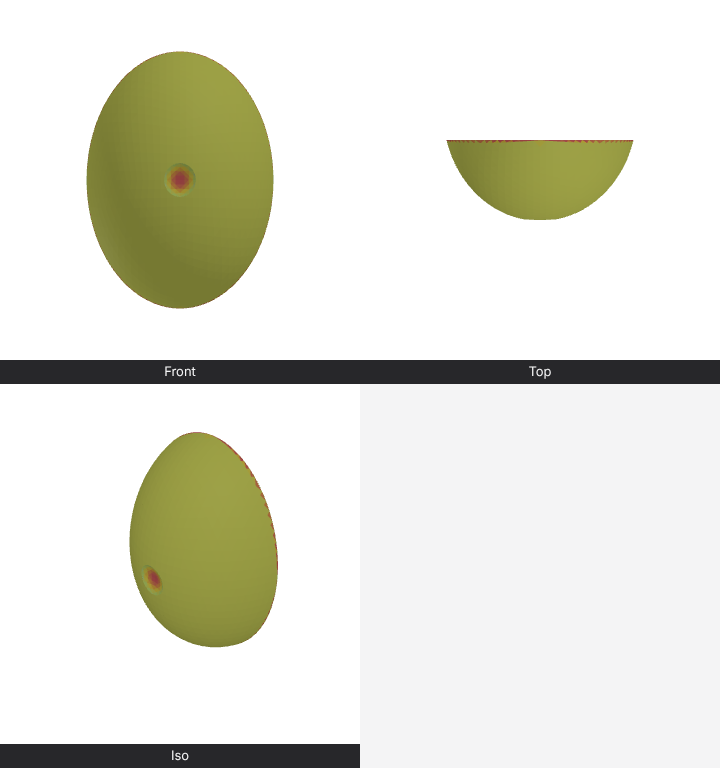

**Console panel**: the last run's `console.log` output in a drawer at the bottom of the viewport (dark, light, 375 px).

| Dark | Light | Mobile |
|---|---|---|
|  |  |  |

**Reference ghost in `renderViews`**: a mask with the head set as reference geometry. The nose visibly pokes through the front.

**Annotated sections**: x cut from the right, z cut from above, y cut from the front. Each has a caption, axis arrows, a scale bar and extents, with the head's section dashed green. The hollow wall now renders as a ring, not a filled disc.

| x = 0 | z = 5 | y = −10 |
|---|---|---|
|  |  |  |

**Thickness heatmap**: a 1.5 shell with a dish ground into the front (0.53 left) and a knife-edge rim. Threshold 1.2: red ≤ 0.6, yellow at 1.2, grey ≥ 2.4.

