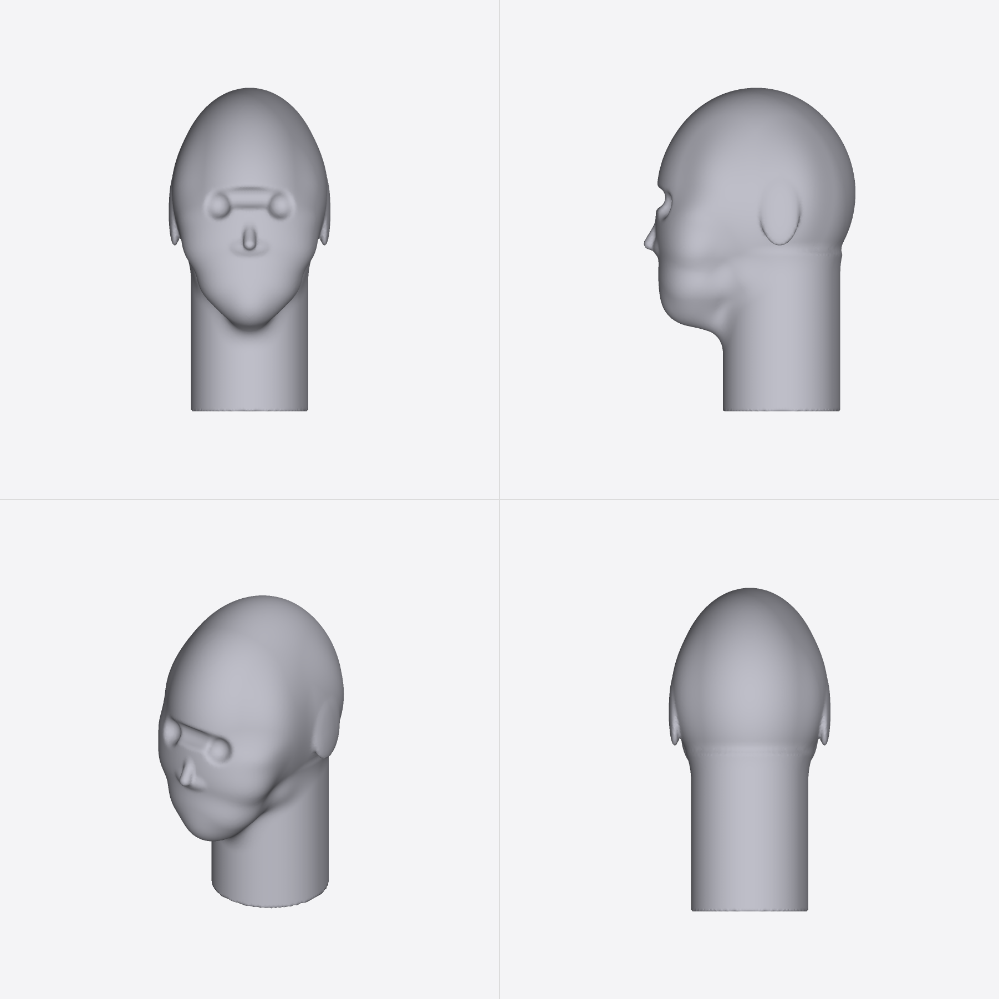
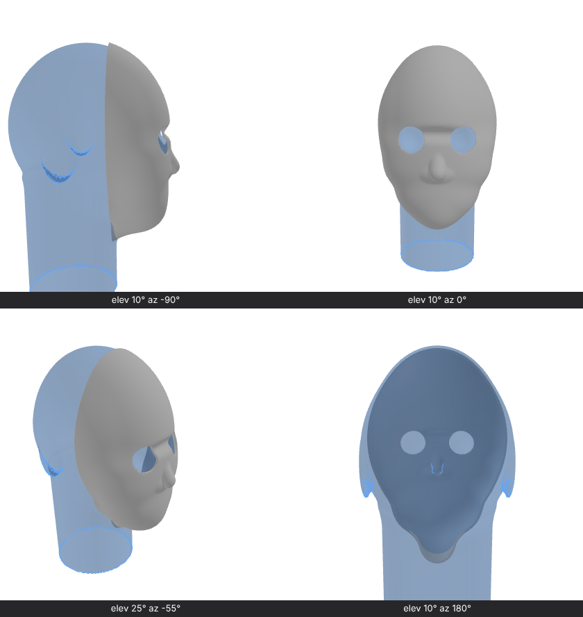

`api.headform()` (neutral, size M), from `model:preview`:

The mask recipe from `/ai/headform.md` (grey) over `api.headform()` set as reference geometry (blue ghost) in `renderViews`: 2 mm clearance, eye holes on the pupil landmarks.

