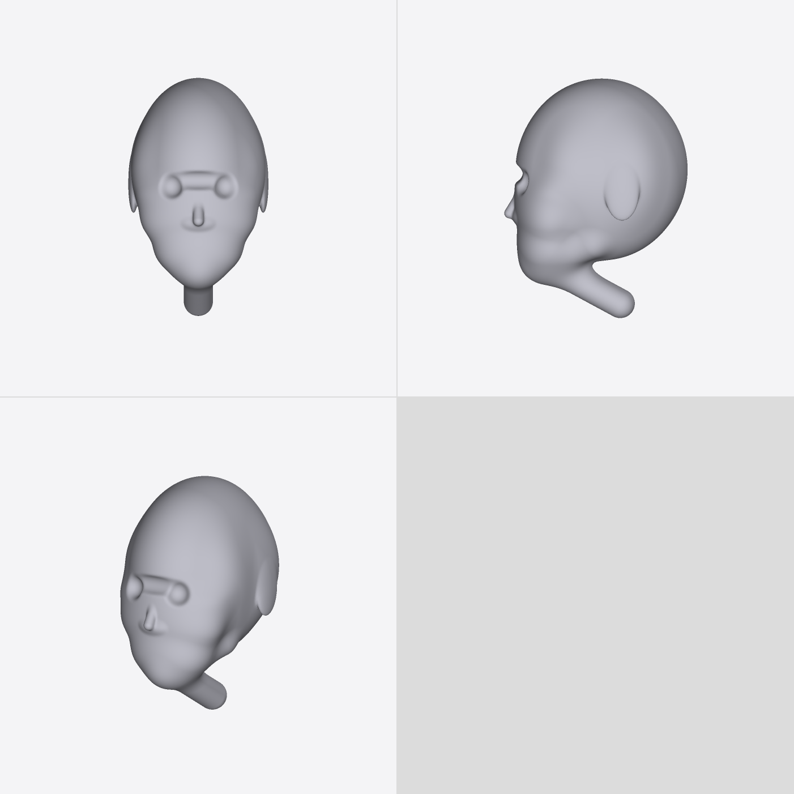
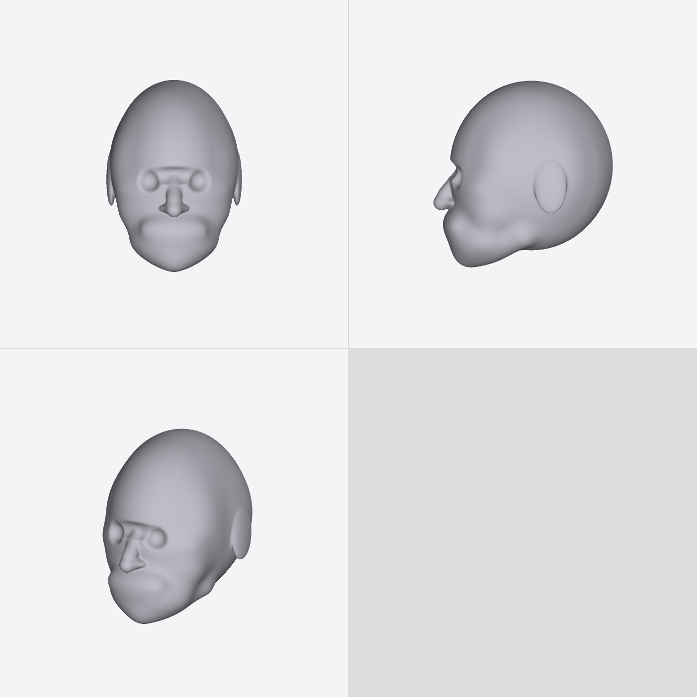
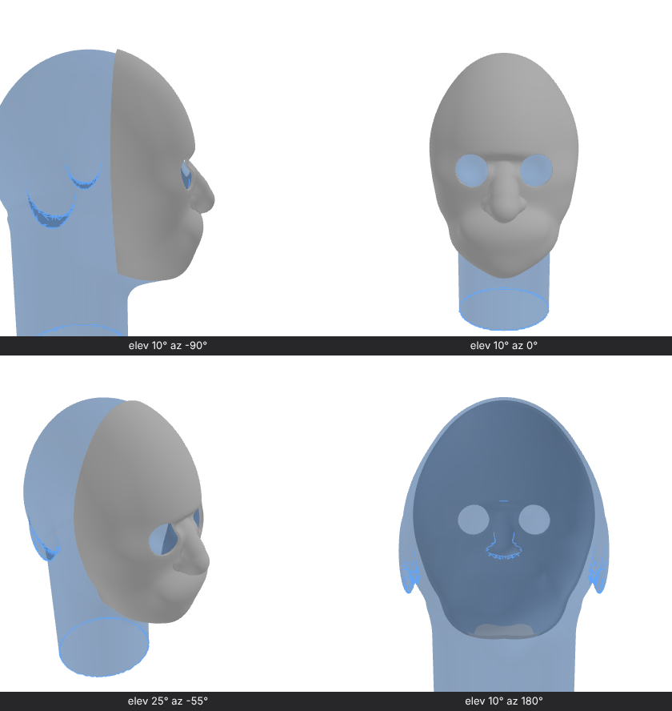

The headform's face is rebuilt from survey data: ANSUR II for the head, NIOSH 2003 for the nose and jaw. The nose now measures 34.9 mm wide with 20.5 mm of tip protrusion, and stands proud of the cheeks. Before, it was a narrow bump on a flat face.

| Before | After (this PR) |
|---|---|
|  |  |

The mask recipe from `/ai/headform.md` (grey) over `api.headform()` as reference geometry (blue ghost), in `renderViews`:

