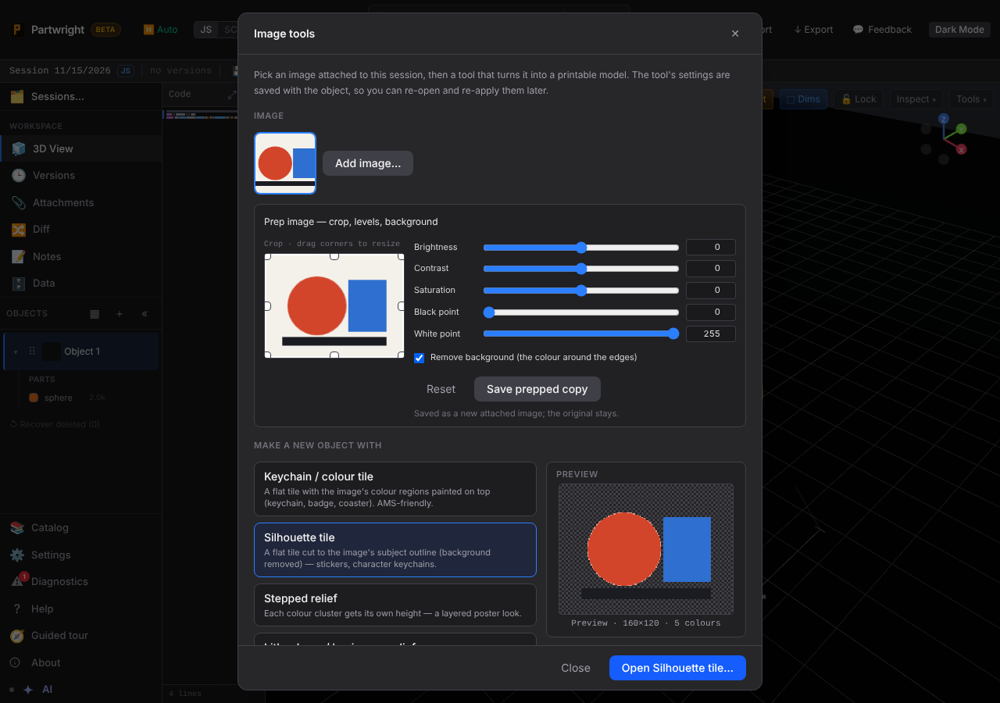
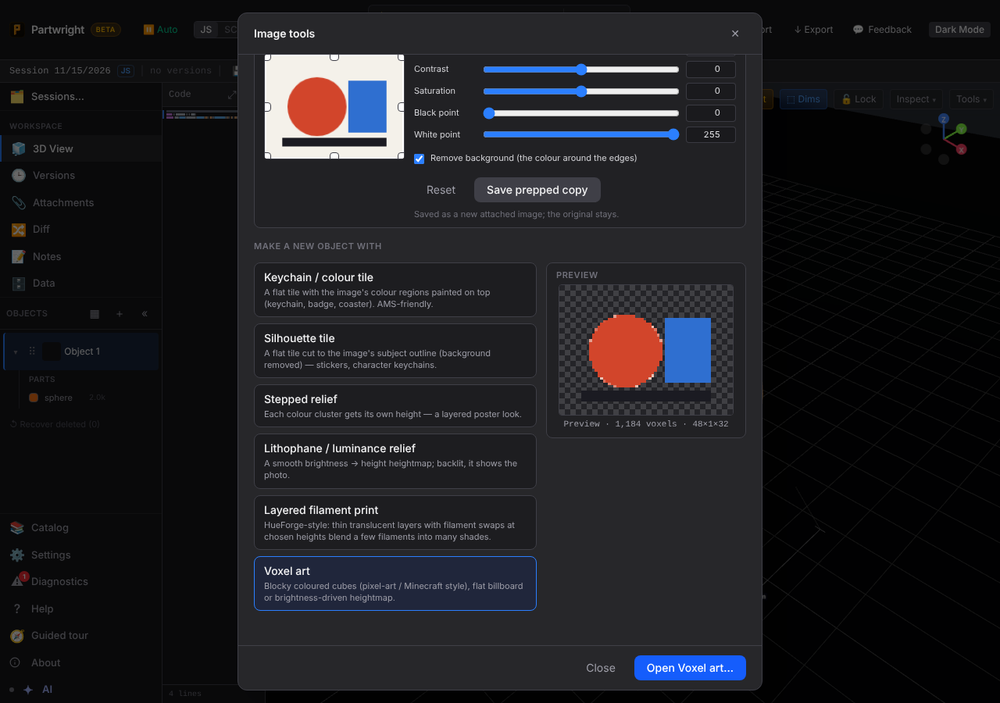
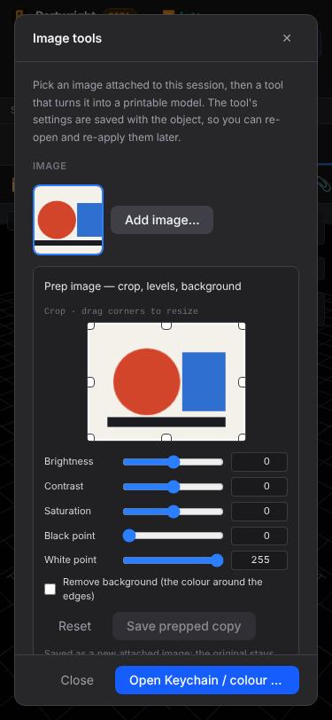
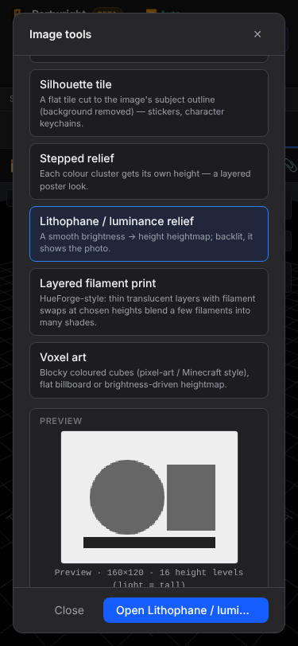
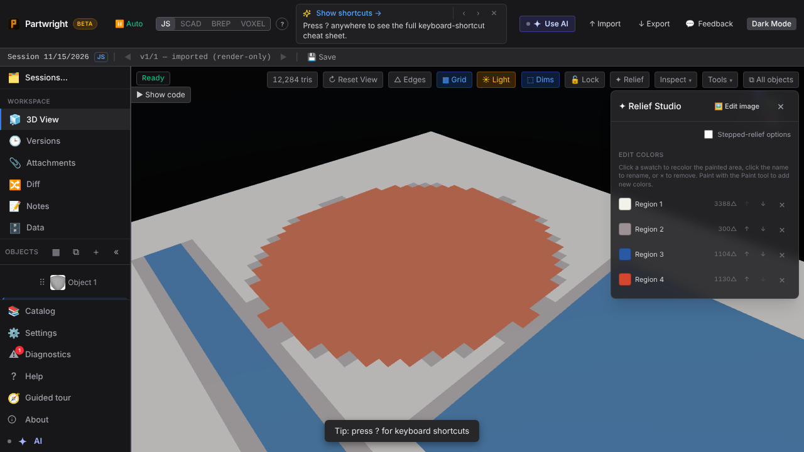

Image tools panel: prep the selected image (crop, tone, background removal) and preview the selected tool before opening it. Synthetic test image.

| Prep + silhouette preview (desktop) | Voxel preview of the prepped image (desktop) |
|---|---|
|  |  |

| Prep at 375 px | Lithophane preview at 375 px |
|---|---|
|  |  |

Relief Studio follows the open object: shown for the tile object (it hides for the voxel object made from the same image).

