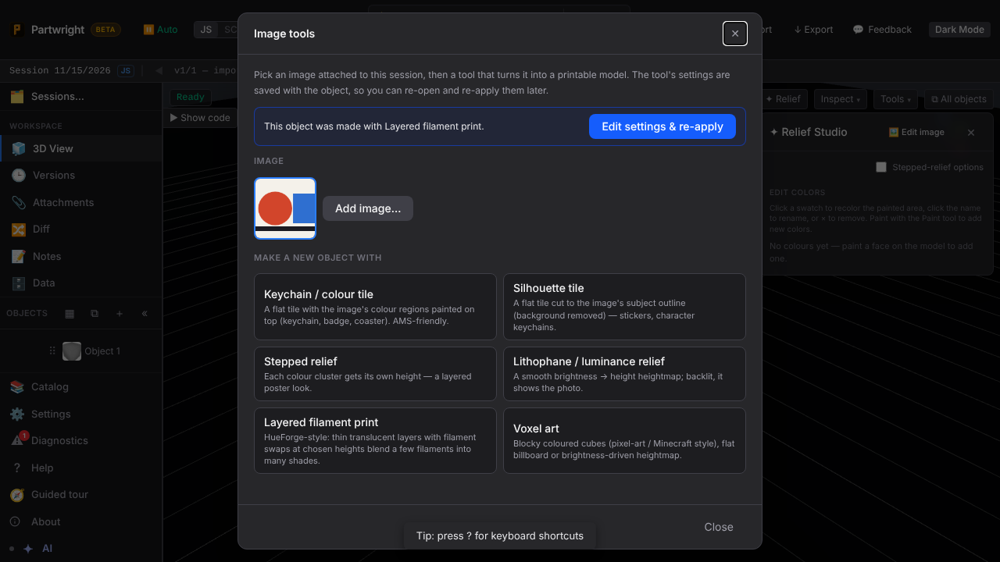
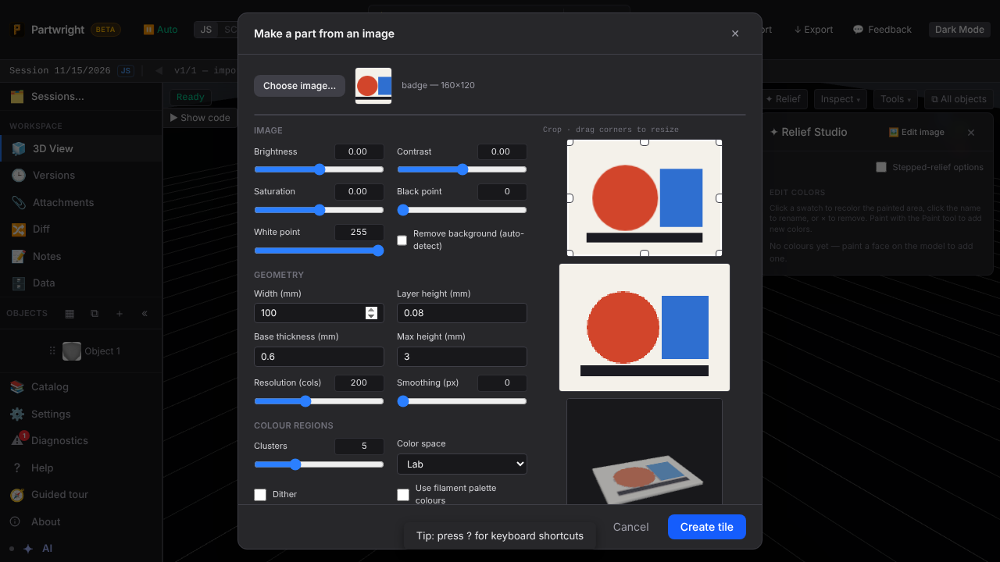

Image tools (Stage A of #1256). Shown with a synthetic test image drawn in the page.

| Image tools panel: attached image, six tools, re-apply for the open object | A tool opens its wizard pre-loaded with the attached image |
|---|---|
|  |  |
