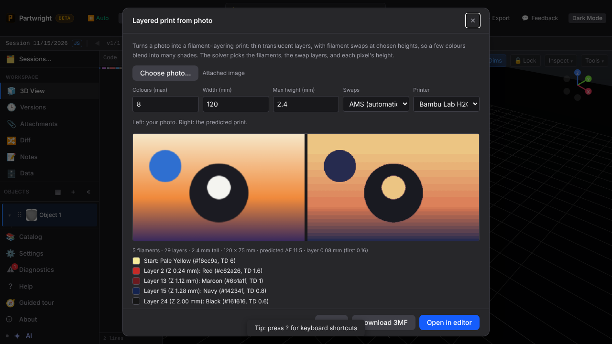
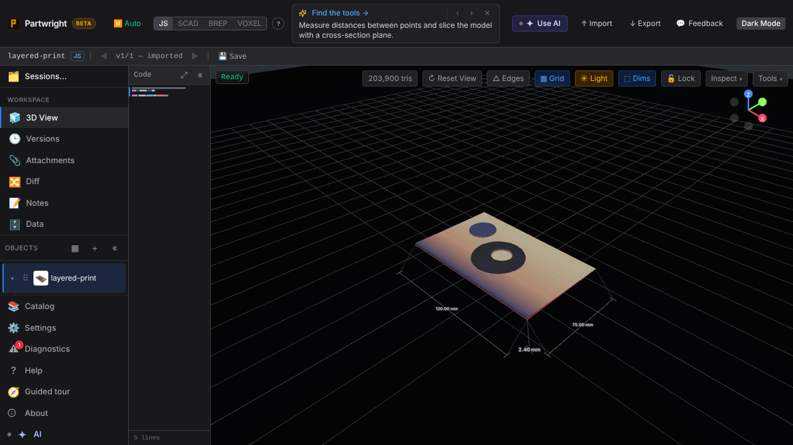

Layered (HueForge-style) photo print — shown with a synthetic test image drawn in the page.

| Dialog: photo vs predicted print, filament stack + swap layers | Result opened in the editor (painted with the predicted look) |
|---|---|
|  |  |
