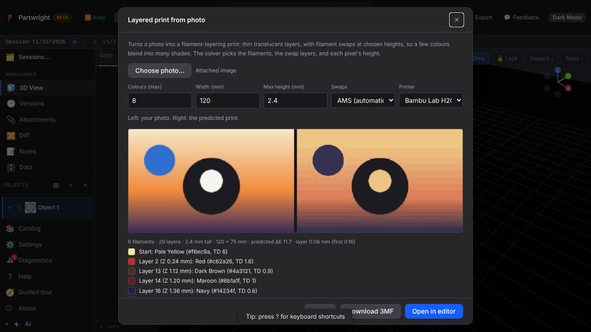
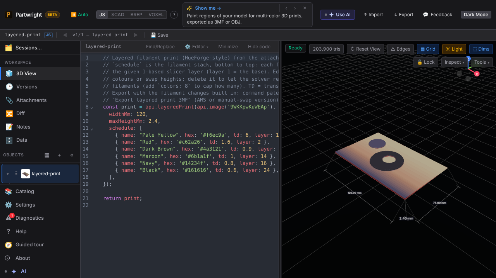

Layered (HueForge-style) photo print, now code-native. Shown with a synthetic test image drawn in the page.

| Dialog: photo vs predicted print, filament stack + swap layers | Opened in the editor: editable `api.layeredPrint(api.image(id), {schedule})` code, model coloured by height |
|---|---|
|  |  |
