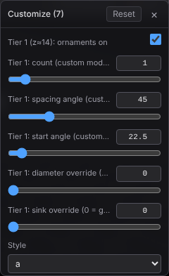
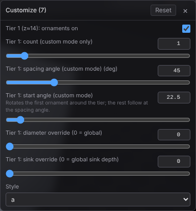
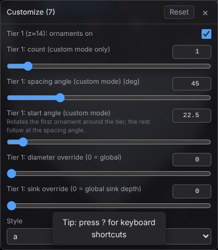

Customize panel with long parameter labels: labels used to truncate; now they wrap, the panel widens to fit (up to 24rem), and a param's `help` text shows under its label.

| Before (main) | After (this PR) | After (375 px) |
|---|---|---|
|  |  |  |
