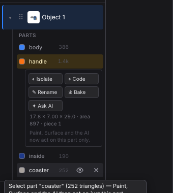
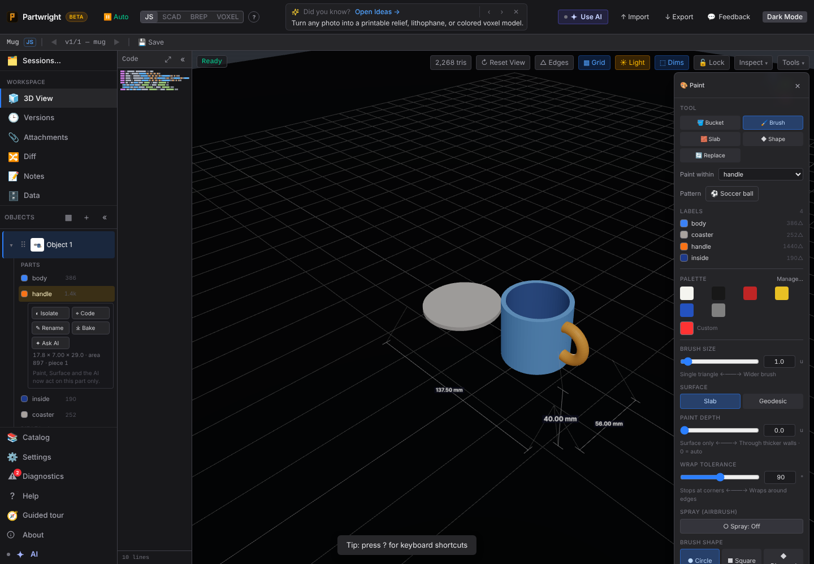

Part editing from the Objects rail, merged with main's part-detection work.

| Rail: selected part drawer + per-row hide / delete | Selecting a part sets the Paint panel's "Paint within" |
|---|---|
|  |  |
