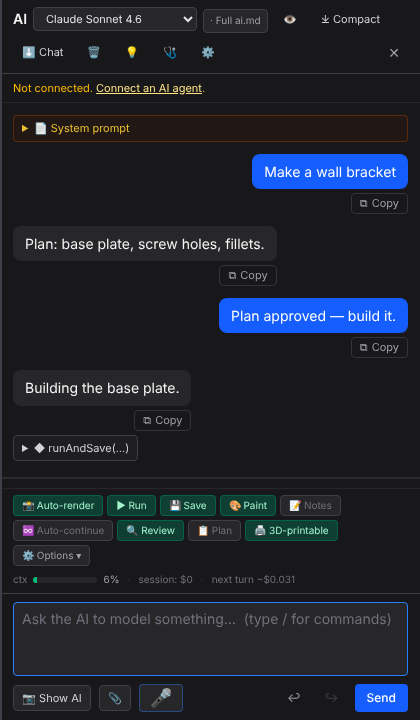
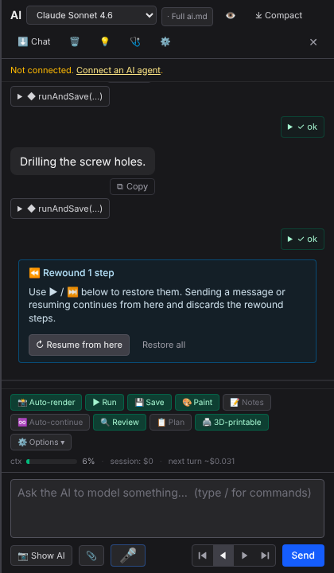
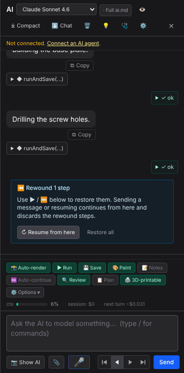

The ↩/↪ pair is replaced by a ⏮ ◀ ▶ ⏭ transport. After one ◀ step back, only the last agent step is gone and a banner explains what's rewound.

| Before (main) | After (this PR) — one step back |
|---|---|
|  |  |

Mobile (375 px):

