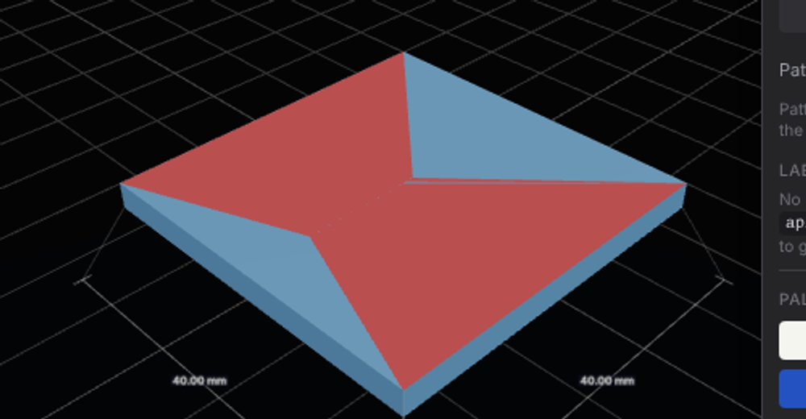
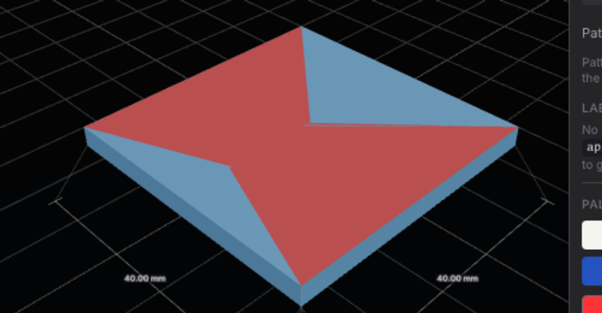

Projection brush (smooth edges off, wrap 180°) dragged across a seam of 0.01-wide sliver triangles running down the middle of the slab's top face.

| Before (main) | After (this PR) |
|---|---|
|  |  |

Before: the seam slivers under the stroke stay unpainted, a faint blue line through the red. After: they're painted with the rest of the stroke; the line remains only beyond the brush (top right).
