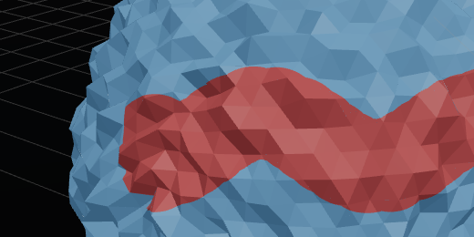
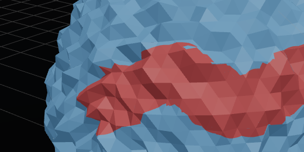
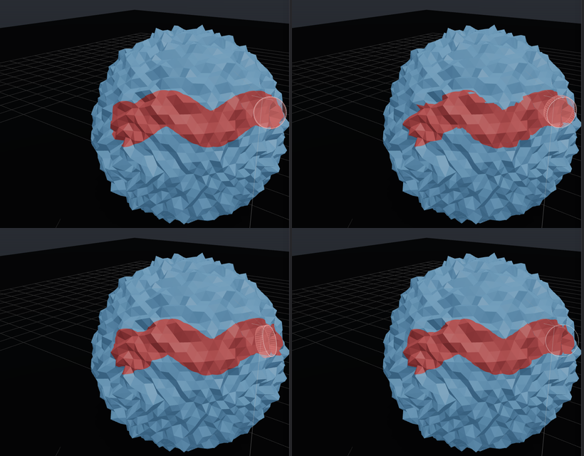
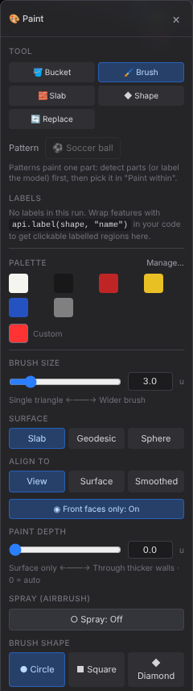
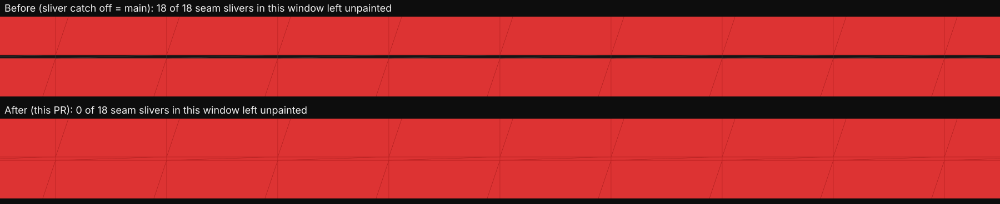
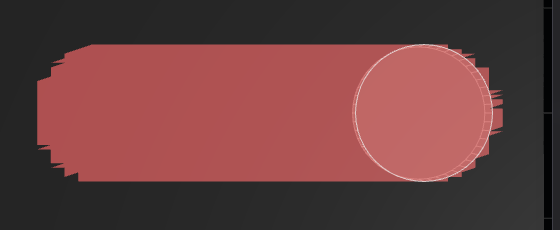

### 1. Brush alignment (new default: View + Front faces only)

The same wavy stroke dragged across a jagged sphere. **View** keeps the brush a circle on screen, so it paints an even band that matches the stroke. **Surface** (the old behaviour) tilts the brush with every facet, so the band comes out ragged.

| Align to: View (new default) | Align to: Surface (previous behaviour) |
|---|---|
|  |  |

All four modes, same stroke (top-left View, top-right Surface, bottom-left Smoothed, bottom-right Sphere):

The brush panel: Surface gains **Sphere**, plus a new **Align to** row and a **Front faces only** toggle. Wrap tolerance is hidden in View mode, which doesn't use it.

### 2. Sub-pixel seam slivers (re-shot as a true A/B)

Both passes ran in one session with an identical top-down camera and stroke; only `ui.paintBrushSliverPx` differs (0 = main's behaviour). The test model is an all-black, finely gridded slab with a seam of 0.01-wide sliver quads down x = 0. Close-up of the seam, drawn from the exact painted triangle sets:

At normal zoom the sub-pixel seam is invisible in both shots (same camera). The earlier pair differed only because it came from two separate runs with different framing.

| Before | After |
|---|---|
|  |  |
