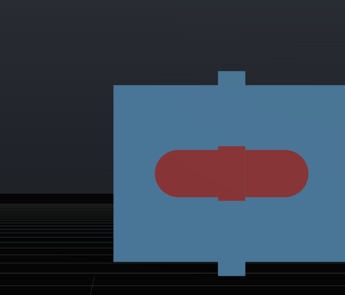
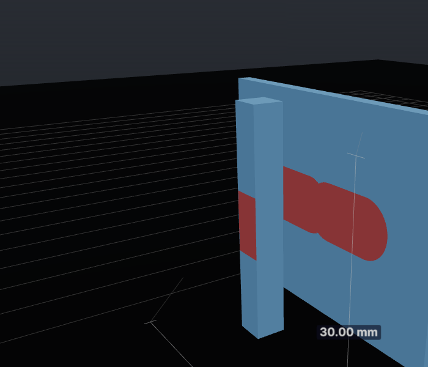
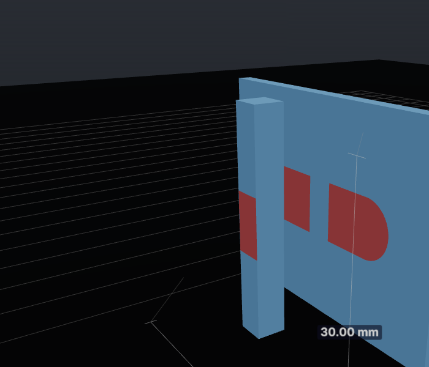
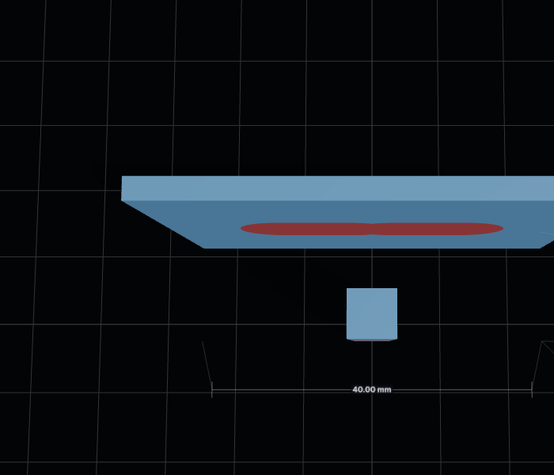
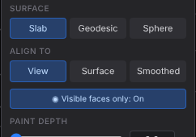

A wall with a free-standing post in front of it (think: an arm in front of a torso). One View-aligned stroke painted across the post from the front, with occlusion off vs on (front faces only in both). Same scene, same stroke, same cameras.

| | Occlusion off (before) | Occlusion on (this PR) |
|---|---|---|
| Painting view (front) |  |  |
| Swung round behind the post |  |  |
| Top-down |  |  |

From the painting camera the two look identical: everything visible is painted. From the side, the "before" band continues across the wall hidden behind the post; with occlusion the wall behind the post is left alone (2856 → 2458 painted triangles).

The brush panel's toggle is now **Visible faces only**: the facing test plus occlusion, on by default.

