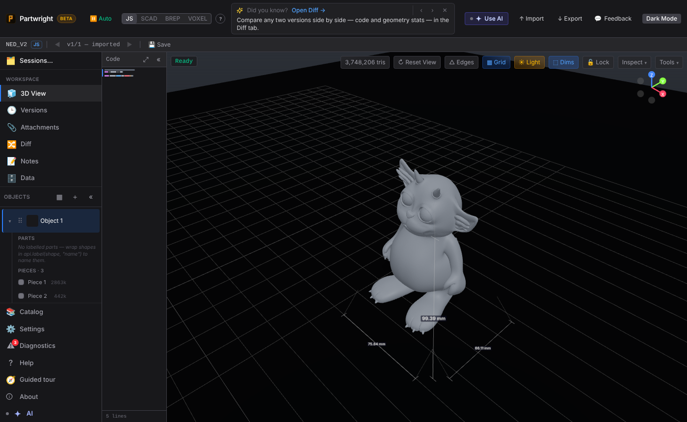

Importing a 3.7M-triangle STL (187 MB): the Worker checks the mesh behind a cancellable progress modal while the UI stays live, then the model opens.

| While importing | Imported |
|---|---|
|  |  |
