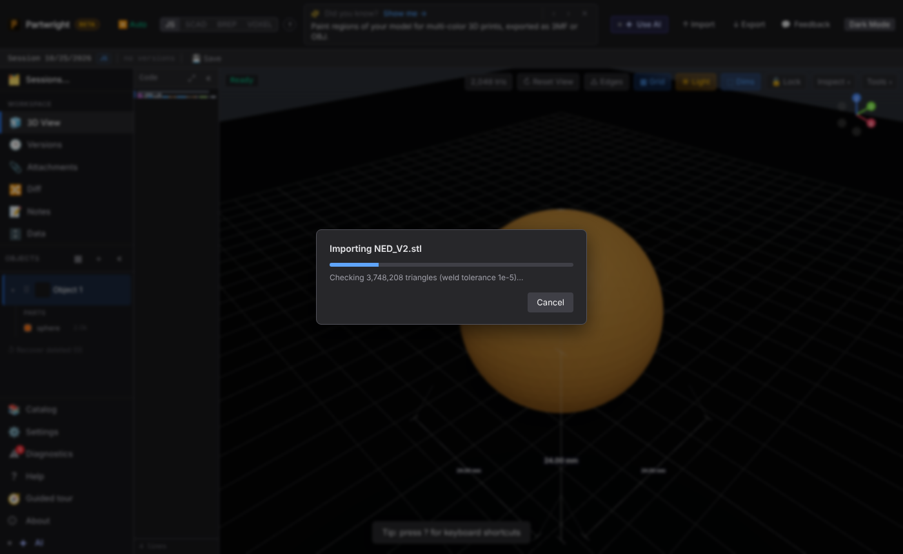
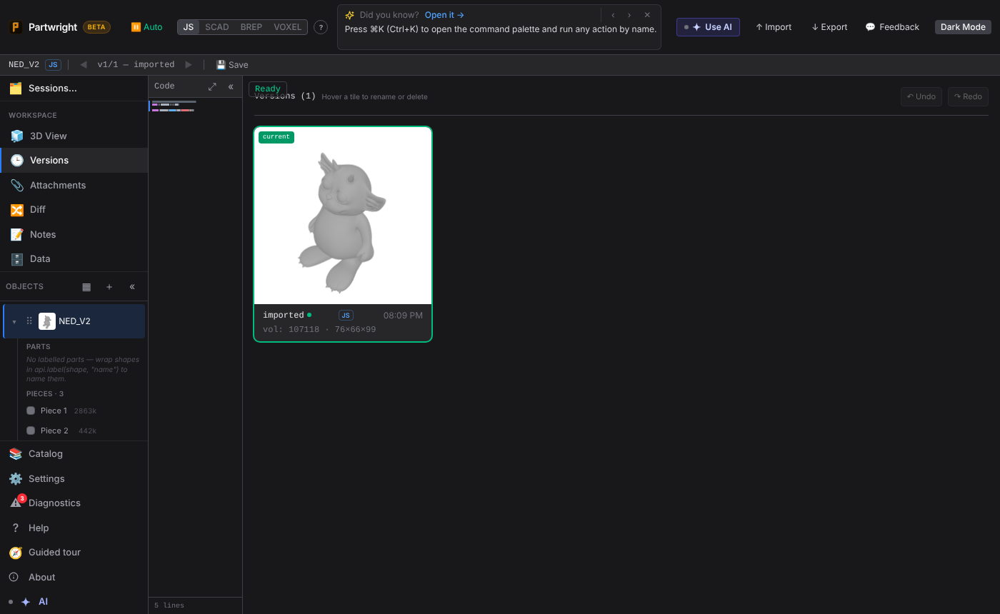
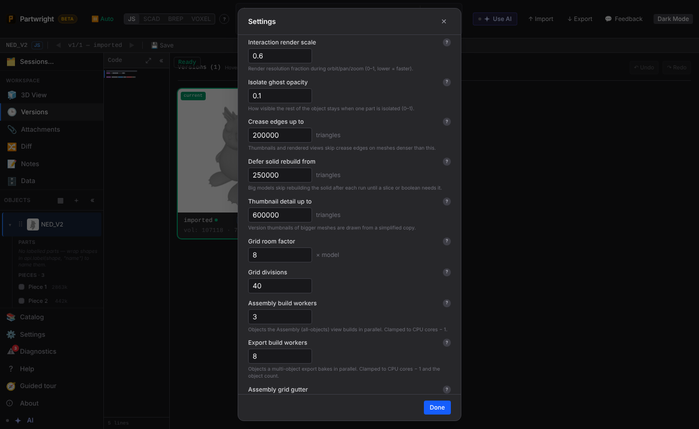

Importing a 3.7M-triangle STL (187 MB). The probe runs in a Worker behind a cancellable progress modal, and the UI stays live. The model opens as an object named after the file, and its version thumbnail is drawn from a simplified copy (before this PR, this file saved with a blank thumbnail).

| While importing | Imported |
|---|---|
|  |  |

| Version thumbnail + object name | New Advanced Settings fields |
|---|---|
|  |  |
