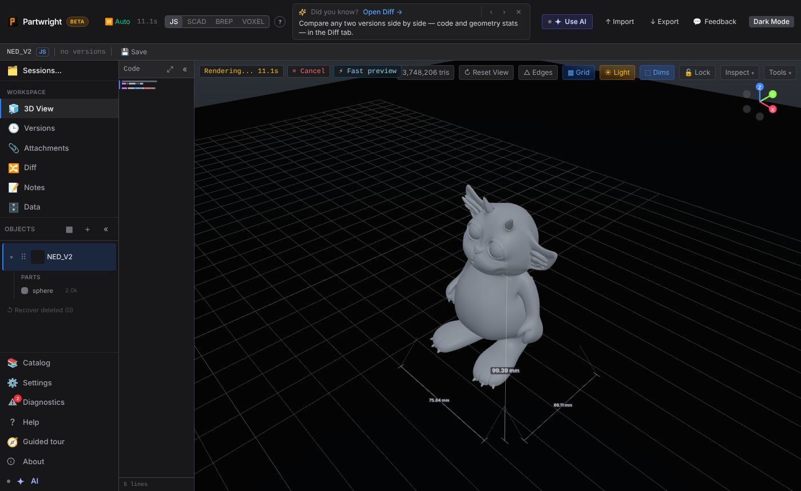

Importing a 3.7M-triangle STL: the mesh appears straight away under the "⚡ Fast preview" pill while the engine rebuilds the solid in the background ("Rendering… 11.1s", cancellable). The same preview shows the first time a big object is opened after a reload.

