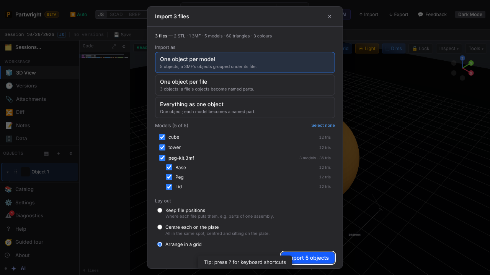
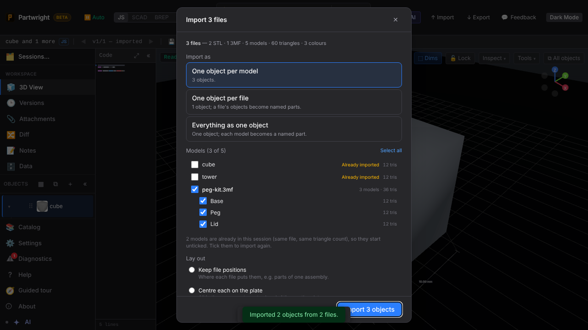
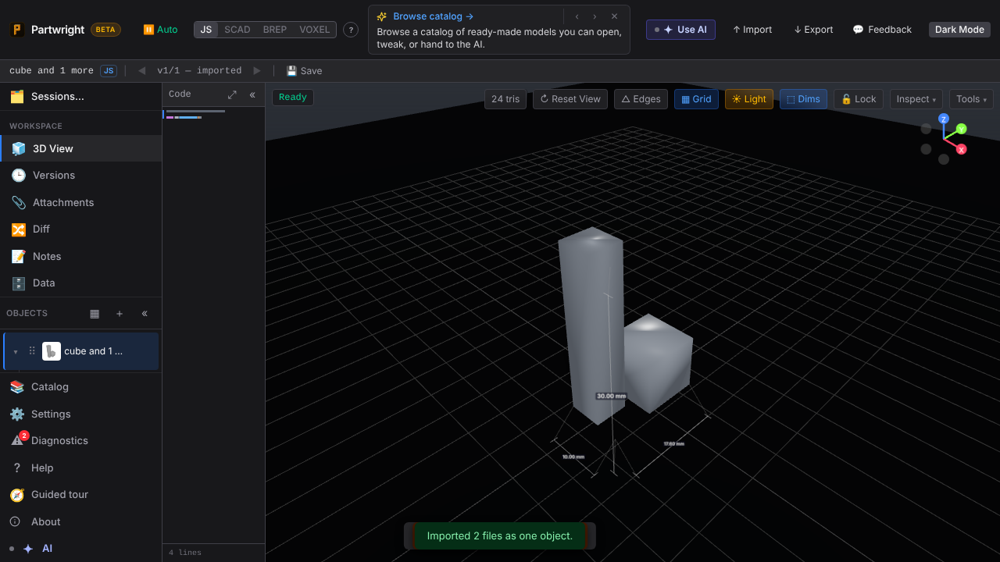
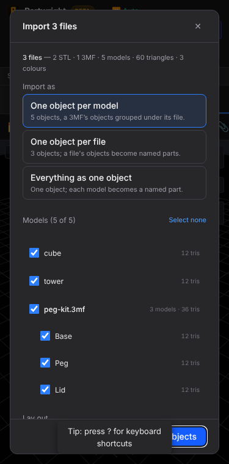

Several STL and 3MF files picked or dropped at once open one **Import N files** dialog.

| The dialog (2 STL + a 3-object 3MF) | Re-importing: models already in the session start unticked |
|---|---|
|  |  |

| "Everything as one object", arranged in a grid (each model a named part) | Mobile (375 px) |
|---|---|
|  |  |
