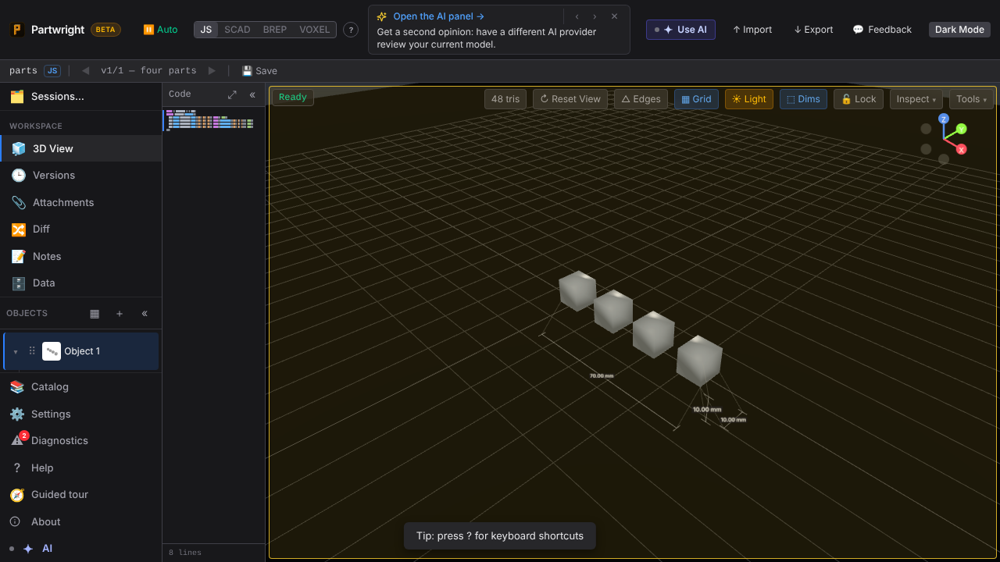
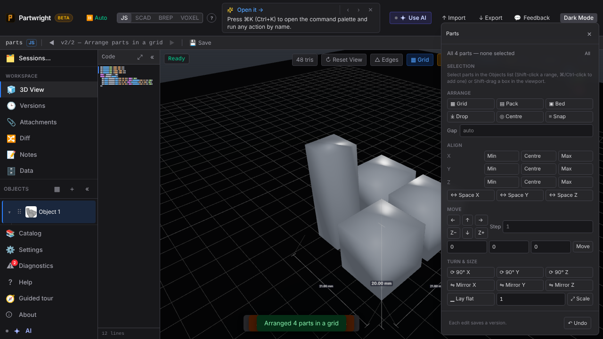
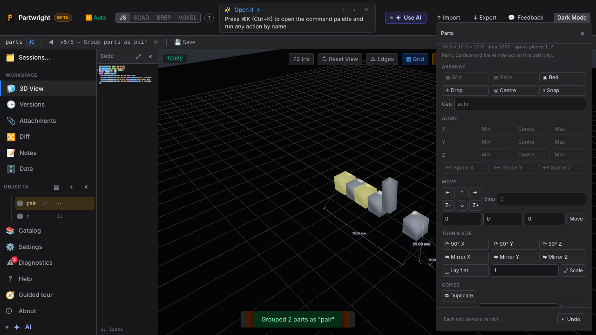
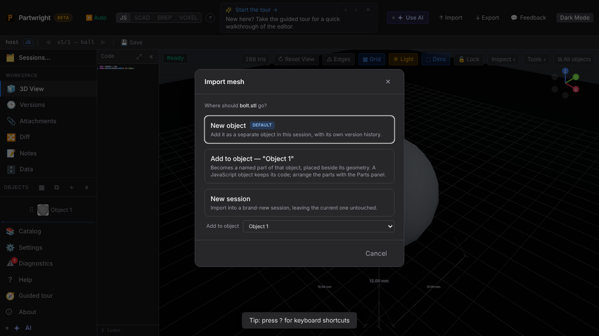
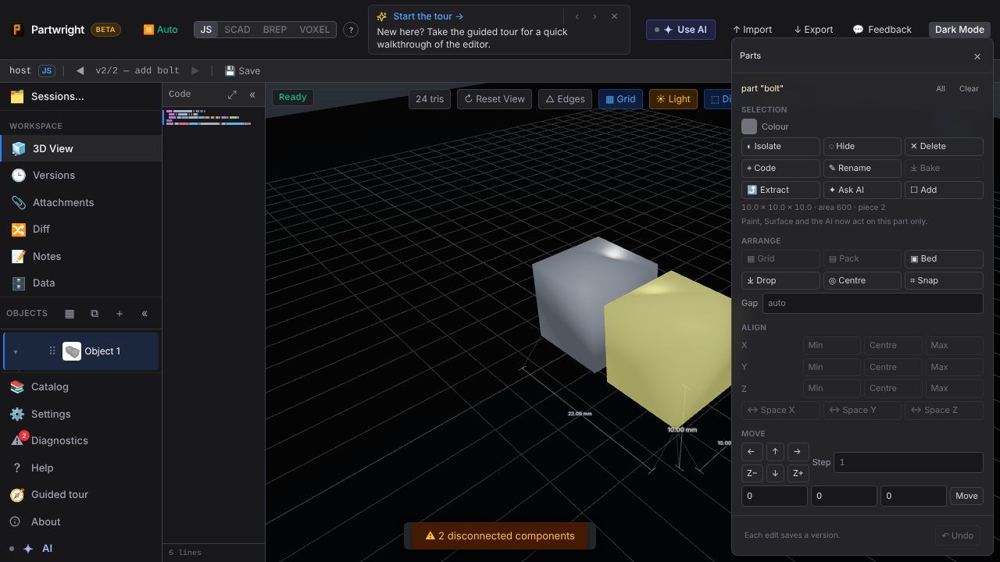
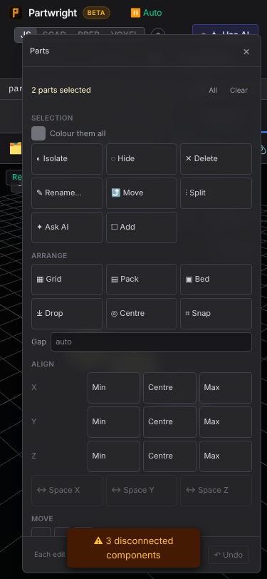

**Selection** — Shift-drag box-selects parts in the viewport.

**Parts panel** — Grid arrange with nothing selected (left); two parts grouped as "pair" after Duplicate (right).

| Grid | Group |
|---|---|
|  |  |

**Import into any object** — the dialog's object picker (left); the model added as part "bolt" beside the object's geometry, selected in the Parts panel (right).

| Picker | Added |
|---|---|
|  |  |

**Mobile (375 px)** — the Parts panel with two parts selected.

