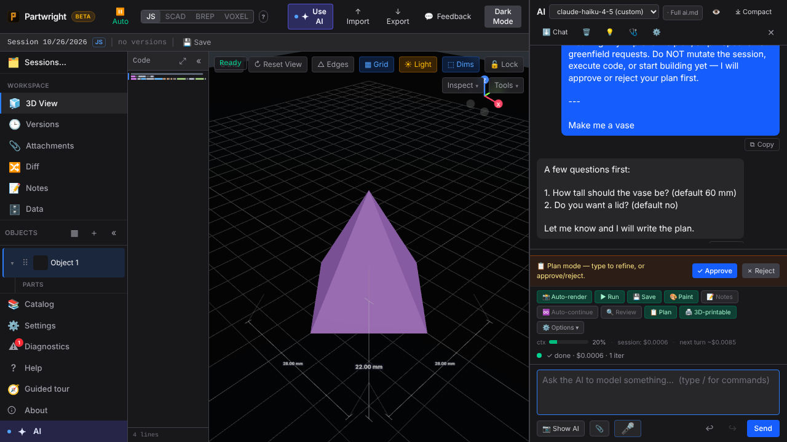
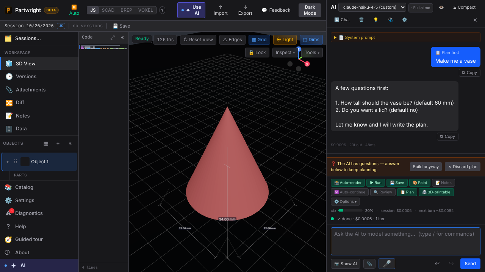
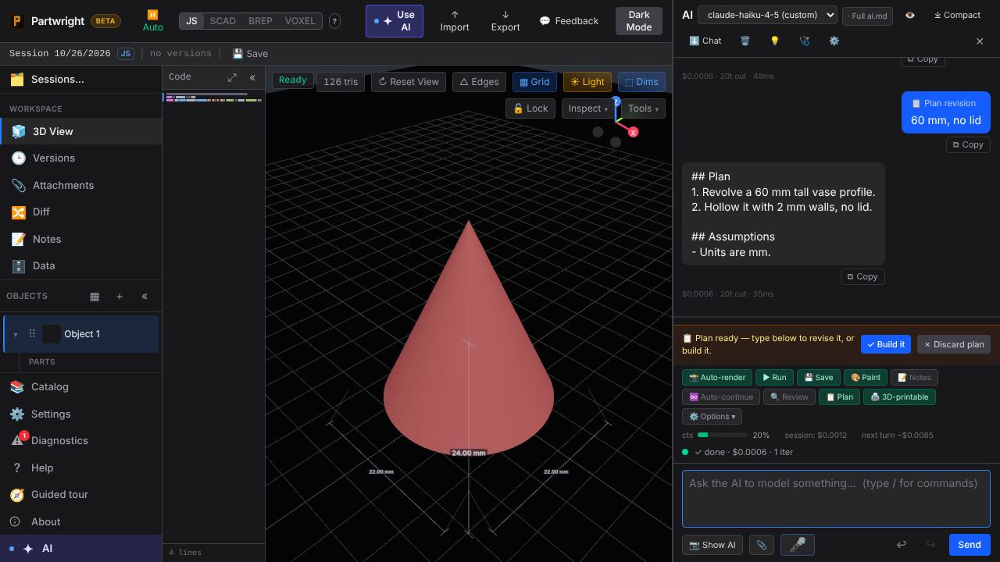
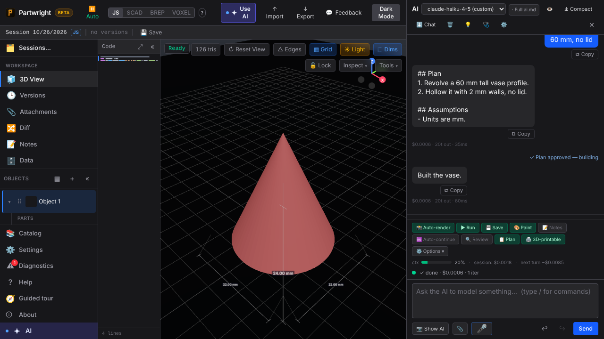

Plan mode when the AI answers a plan request with questions.

| Before (main) | After (this PR) |
|---|---|
|  |  |

After the user answers, the plan is ready to build; Build sends the plan and shows a one-line marker.

| Plan ready | Approved and built |
|---|---|
|  |  |
