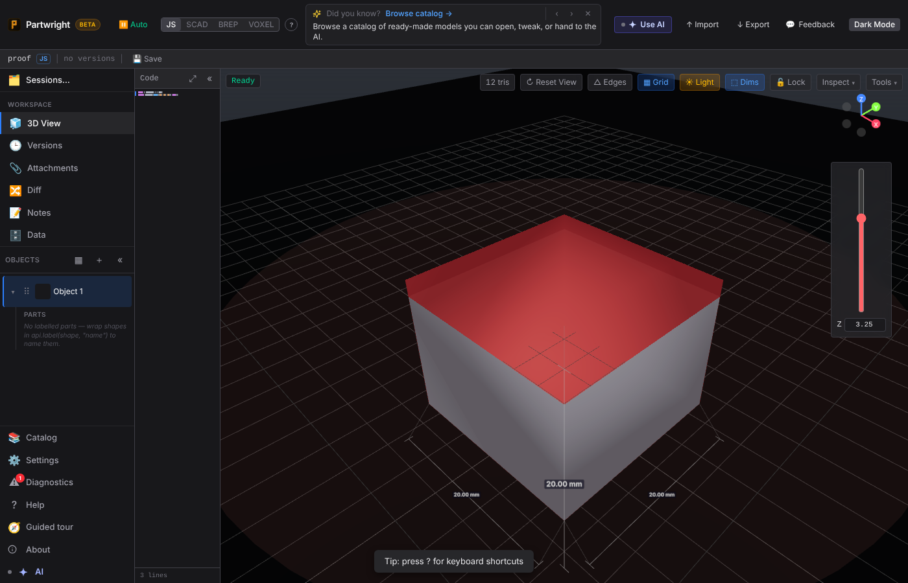
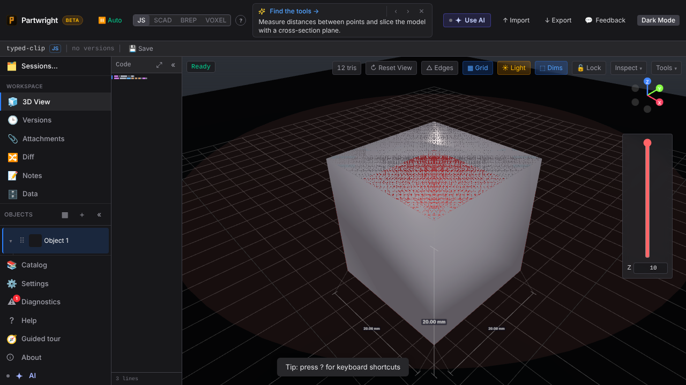
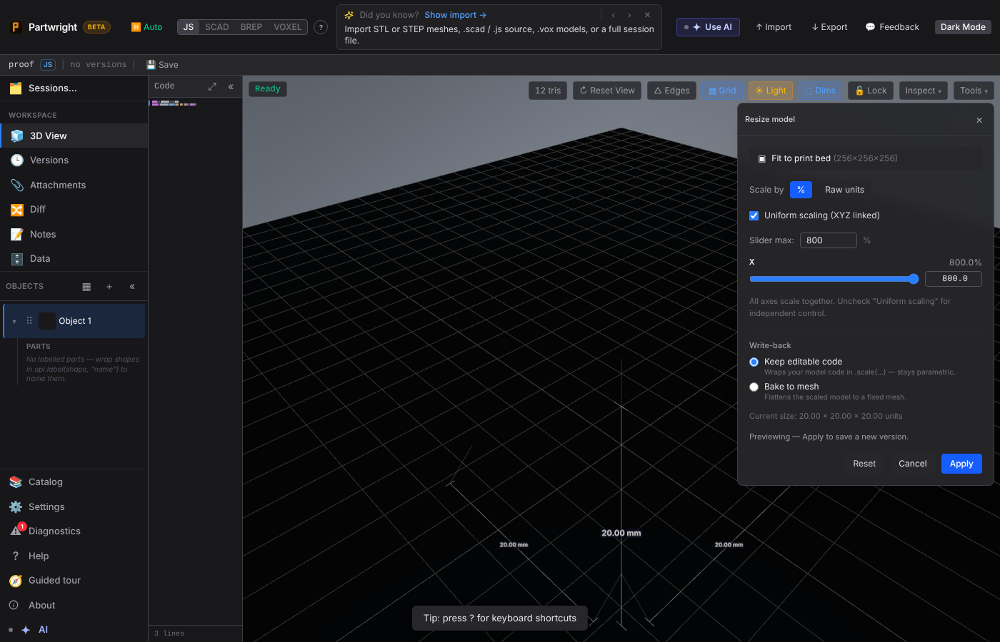
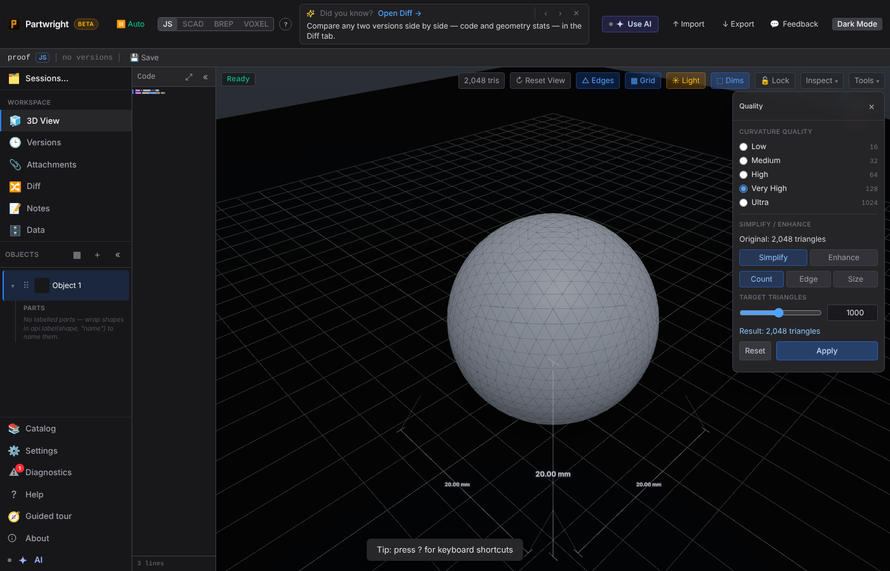

# Visual proof — claude-optimistic-gauss-ofleuq

## Cross-section clip height: typed 3.25 in the new Z box (the thumb snaps to its 0.1 step; the clip uses 3.25)

## Cross-section clip height: 999 typed is clamped to the model top (10)

## Model params panel: Width typed to 150, past its declared 100 max — the slider range grows to include it

## Resize: 800% typed past the 500% slider max — slider max and the Slider-max box grow to 800

## Simplify: target triangles typed as 1000 via the shared slider entry

