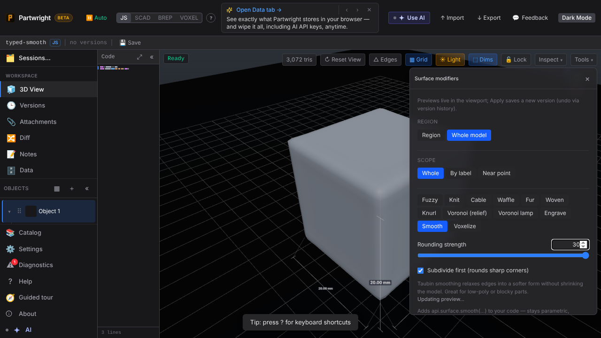
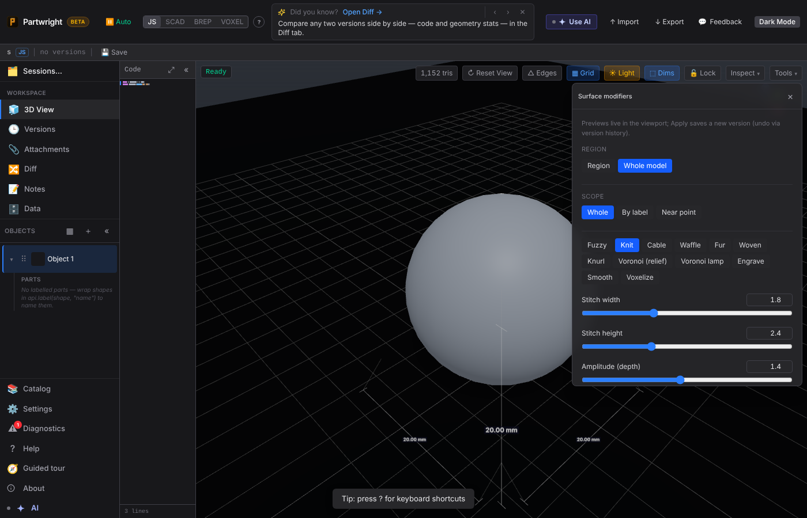
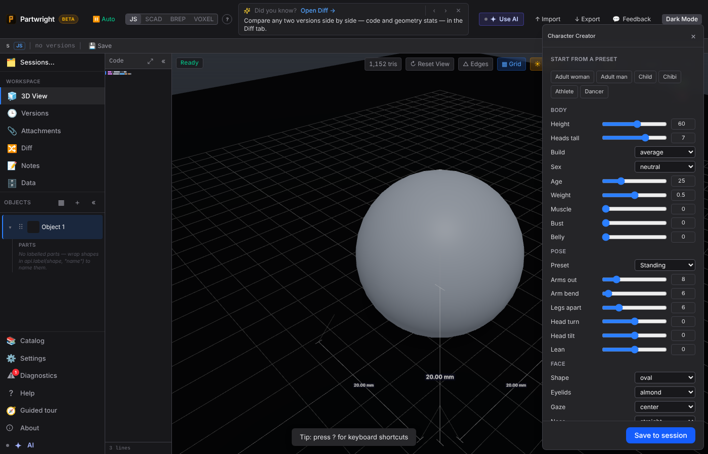
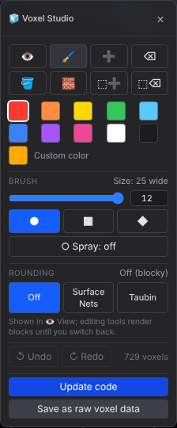
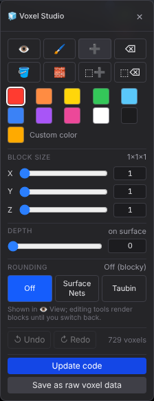

# Visual proof — claude-optimistic-gauss-ofleuq

## Surface → Smooth: 30 typed past the slider's 12; the thumb pins, Apply writes iterations: 30

## Surface → Knit: every numeric slider now has a typed box

## Character Creator: typed boxes on every slider (Height no longer capped at 90)

## Voxel Studio brush: radius 12 typed past the slider's 8 → '25 wide'

## Voxel Studio add-block: X/Y/Z size boxes (typed up to 32)

