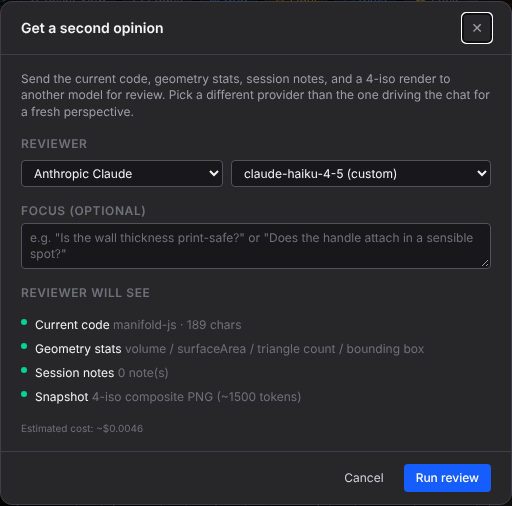
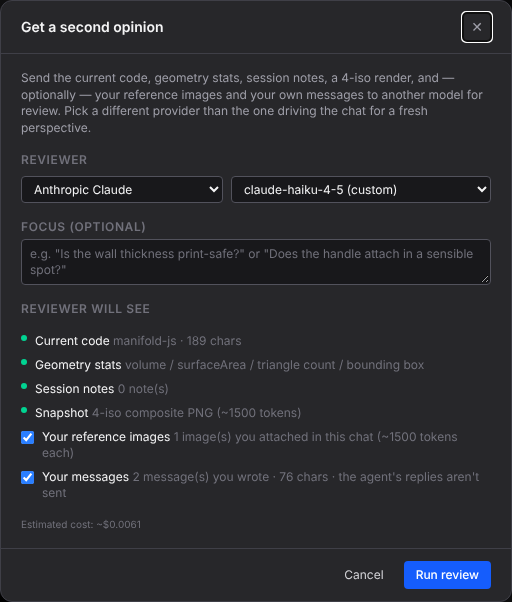
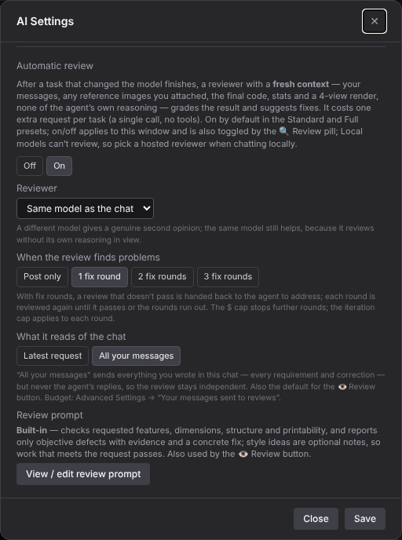

The 👁 review modal now lists your reference images and your own messages (each optional), with the cost estimate counting them.

| Before (main) | After (this PR) |
|---|---|
|  |  |

AI Settings → Automatic review gains "What it reads of the chat":

