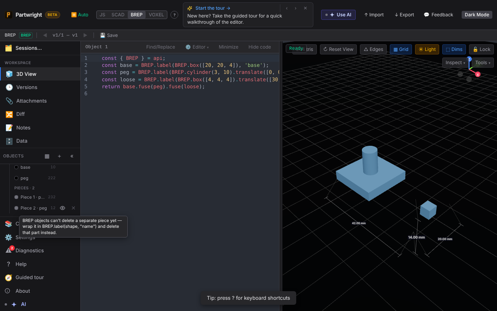
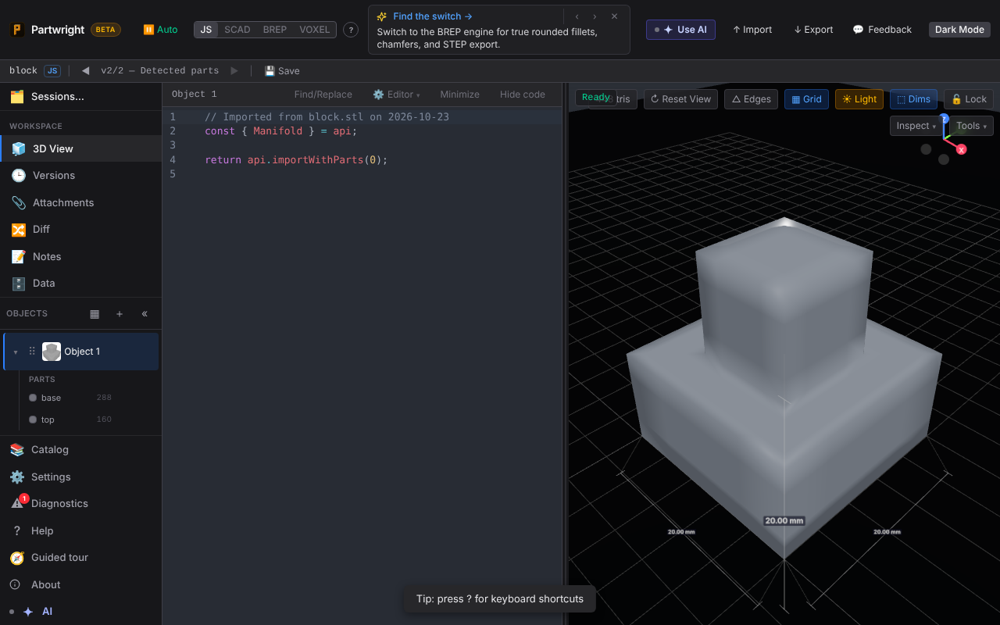
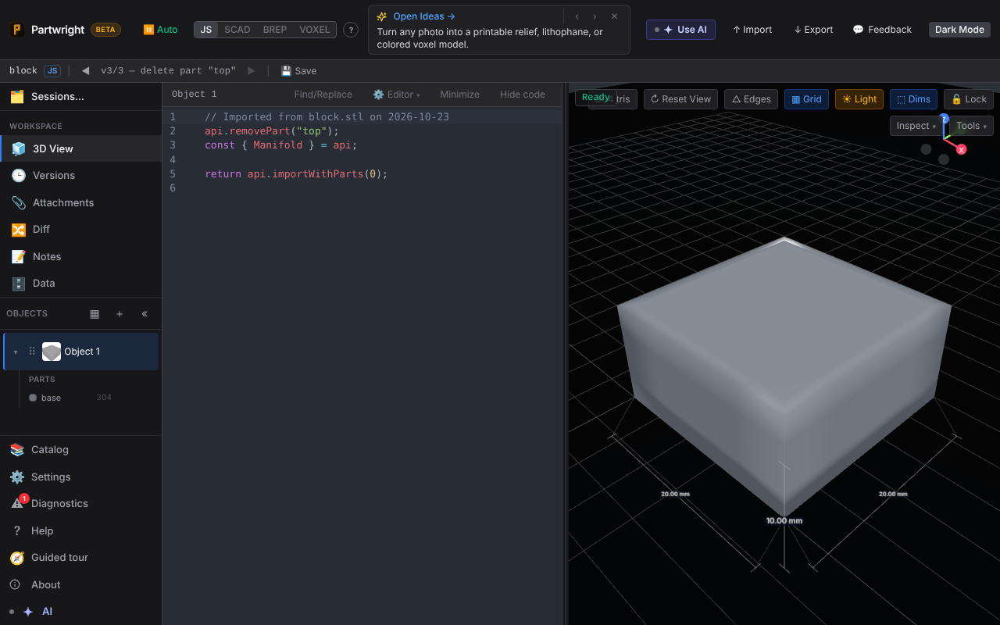

BREP piece ✕ is disabled and explains why:

Imported mesh with detected parts, before and after deleting "top" (the opening is capped flat and counted as `base`):

| Before | After |
|---|---|
|  |  |
