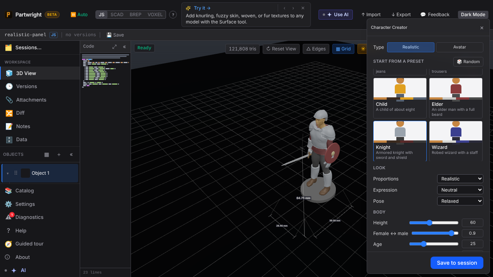
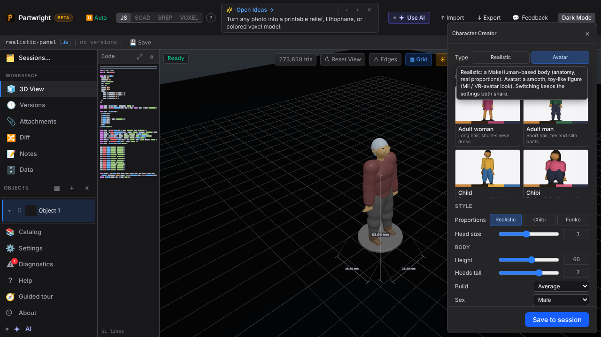
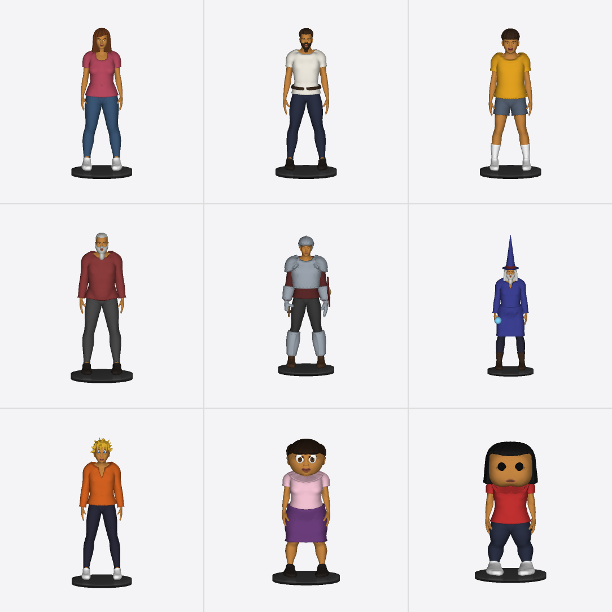

The Character Creator's new **Type** switch: Realistic (`api.human`) or Avatar (`api.sdf.figure`).

| Realistic: the Knight preset | Switched to Avatar (shared settings carried) |
|---|---|
|  |  |

The nine Realistic presets, built headlessly (each one printable piece):

