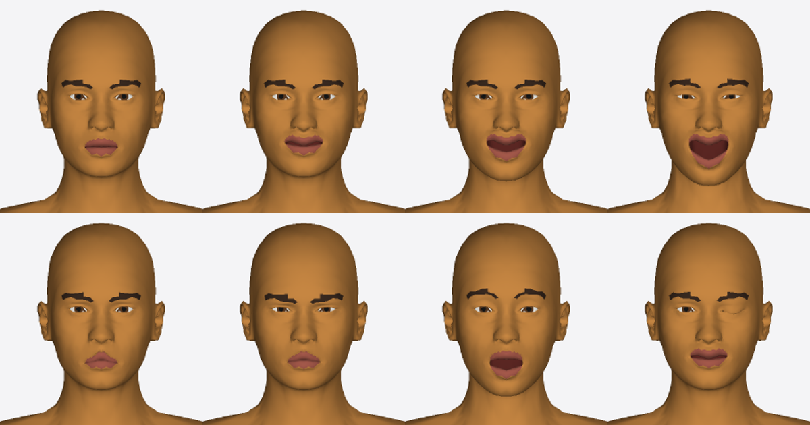
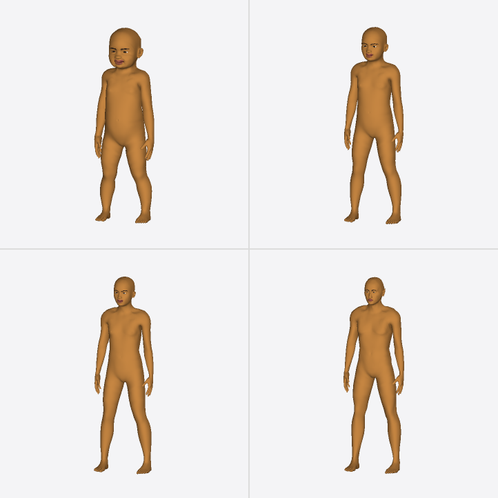

**Expressions** (they move the face bones, so they work on any face, age or pose): neutral, smile, grin, laugh / frown, angry, surprised, wink

**Child ages and raw MakeHuman sliders**: age 2, 6, 11 (smiling), and an adult with `morphs: { 'nose-hump': 1, 'head-oval': 1, pointed ears, … }`

